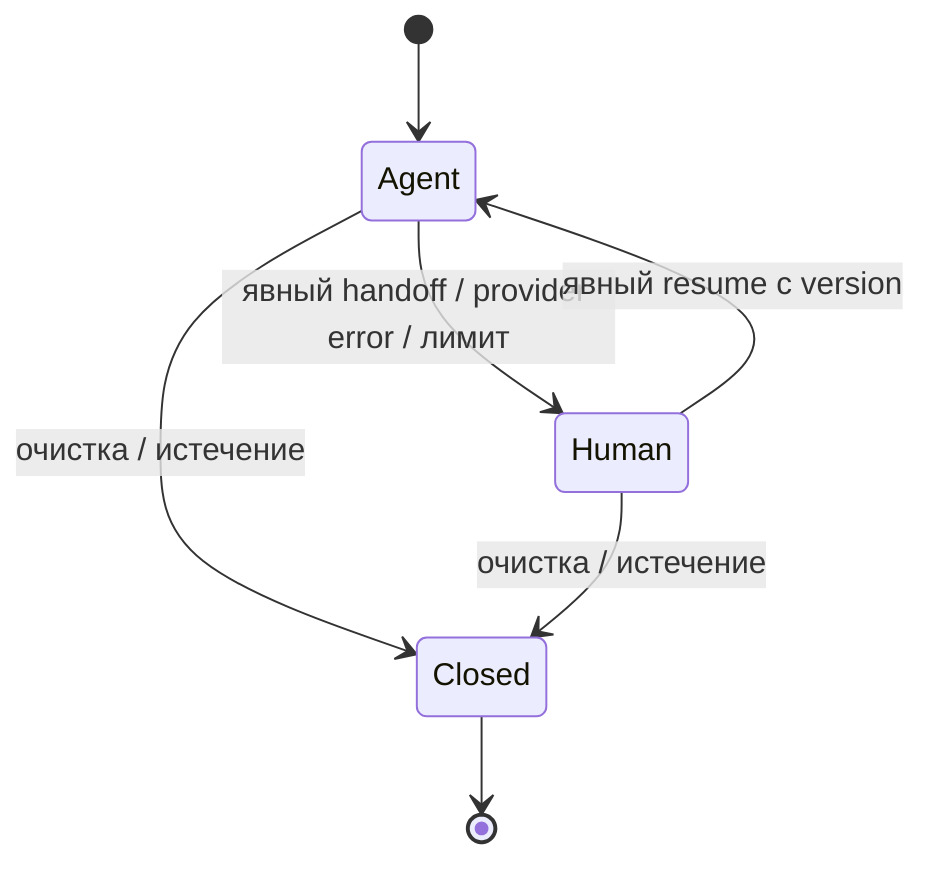

# Тестовые диалоги — этап 5

Защищённая `/dashboard/ai-playground` —внутренний симулятор покупателя/сотрудника, не публичный web-chat и не Telegram. Session/SSR/BFF сохраняются. Доступ owner или member с can_manage_orders только в organization.is_test=true. Обычный магазин предлагает создать отдельный пустой test org; его реальные остатки не используются/не копируются.

## Схема и состояния

Conversations: UUID id/org/customer_id, created_by users FK, channel=internal_chat, is_test=true, control_mode agent/human, status open/closed, version>0, in_flight UUID/lease_until, message_count≤100, created/updated/expires timestamps. Compound uniqueness(org,id,customer) связывает quotes/orders с конкретным симулируемым клиентом. UUID клиента не user ID сотрудника.

Messages: UUID id/org/conversation, role customer/assistant/staff/system/tool, content≤2000 chars, data bounded32768bytes, UUID client_key/idempotency, request_hash, created_at. Staff actor_id users FK; customer идентифицируется synthetic conversation customer_id. Events append-only с actor/kind/time (created/handoff/resumed/deleted/provider_error/limit). Все tenant-owned FORCE RLS, compound FK, staff+test selected context.

Message POST atomically locks conversation, validates status/expiry/role/quota, rejects key reuse with different body, writes customer message + reserved budget + run revision/lease. Повтор key/body возвращает состояние без второго сообщения/LLM. Сотрудник может отправить staff сообщение только в human mode. Concurrent input при действующем lease —409 BUSY, не merge потерь истории.

Handoff атомарно ставит human, увеличивает version, очищает run/lease, пишет событие. Incoming customer messages сохраняются, автоматического Generate нет. Resume только явная защищённая команда сотрудника с version, не фраза клиента. Успешная повторная команда с устаревшей version получает409 и не повторяет side effects. Finalization проверяет run/version/mode после network; гонка handoff не даёт позднего assistant сообщения.

UI показывает режим mock/live, состояние human, настоящие verified cards, даты ручной сверки, quantity/cart, price quote на5min, explicit consent, pending order link. В human mode есть переключатель simulated customer/staff. История ограничена последними40 messages; model context последними10. Ошибки401/403/404/409/422/429/503 не заменяются фиктивными данными. Tenant switch выполняется через memberships, chat/detail другого org не переносится. Loader/error boundary общие существующие Next.js.

## API

O=`/api/v1/organizations/{id}`. GET/POST O/conversations; GET O/conversations/{resource}; POST .../messages {text,role?,idempotency_key}; POST .../handoff|resume|delete {expected_version}; POST .../quotes {items}; POST .../confirm-request {quote_id,accepted,idempotency_key}; GET O/agent/status. Session/Origin/CSRF и staff проверяются сервером. Foreign404, non-test403, quota429, conflicts409. Общий HTTP quota120/min/user. OpenAPI описывает именно эти пути.

## Временное хранение и удаление

Синтетические переписки имеют expires_at через7 дней. Создание не продлевает срок каждого сообщения; это срок всего chat. Истёкший chat не принимает новые сообщения/quotes/consent. List/get выполняют tenant-scoped lazy purge: текст, карточки и request_hash стираются, состояние closed/human; closed metadata/events/order snapshots остаются для проверки событий. Это не background cron, физическое удаление всех audit metadata и backup retention пока не реализованы. При отсутствии обращений к tenant lazy purge не выполняется немедленно в день7; срока физического удаления не обещаем. Перед реальными ПД нужна согласованная автоматическая maintenance policy.

Явная owner/staff «Очистить переписку» стирает сообщения/данные/hash и закрывает диалог сейчас, не отменяет заявки и не меняет резервы. Заказы можно независимо завершить/отменить; снимки названий/SKU остаются (только синтетические). Полные сообщения/prompts/API keys/cookies никогда не логируются. Email/phone редактируются перед моделью, но не применять это как разрешение реальных данных.

Нет customer contacts/phone collection, Telegram webhook, public chat token, продления quote или автоматической гарантии цены/наличия. Реальные каналы и system principal/queue —ТЗ6. Фактические тесты и границы —STAGE_5_REPORT.

## Этап6 Telegram

channel telegram, customer UUID через integration/user/chat principal; employee created_by nullable для channel-created conversation, audit actorNULL обозначает customer/system, не owner. Existing human control/lease/version/events/messages reuse, staff replies trigger outbox в том же commit. Config TELEGRAM_RETENTION_DAYS1–30 (default7) для новых TG conversations; worker closes expired + clears messages and channel inbox/outbox payload. Explicit delete тоже очищает channel payload. Metadata/principals/orders/audit сохраняются; real production privacy/anonymization/backups не включены. Нельзя считать temporary synthetic expiry полной политикой ПДн.
