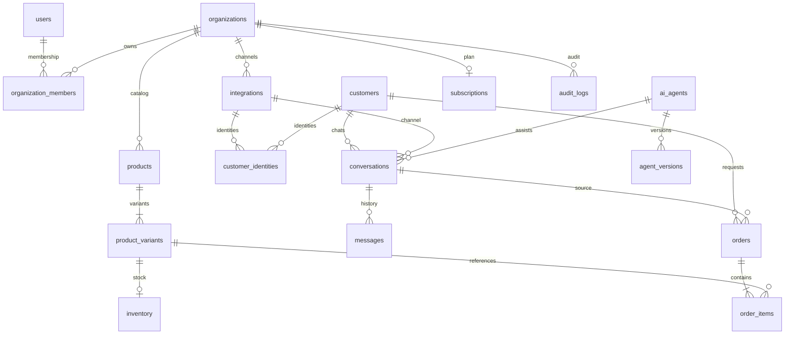

# Предварительная схема PostgreSQL

> ТЗ № 2: реализован только технический каркас. Ниже — целевая архитектура, а не перечень готовых бизнес-функций. Фактический запуск и проверки: [LOCAL_DEVELOPMENT](LOCAL_DEVELOPMENT.md).
Статус: логическая спецификация, не готовая миграция. UUID генерируются backend; даты `timestamptz` в UTC. `NN` — NOT NULL, `?` — nullable; по умолчанию перечисленные поля NN. `created_at` по умолчанию now(). Суммы — bigint в копейках, количество — integer, currency — text CHECK = 'RUB' для MVP. JSONB ограничивается размером и валидируется сервисом; это не место для произвольных инструкций.

## Общее правило ключей и доступа

Каждая tenant-таблица имеет `id uuid PK`, `organization_id uuid NN FK → organizations(id)` и `UNIQUE(organization_id,id)`. Все ссылки между tenant-таблицами составные: `(organization_id, target_id) → target(organization_id,id)` с RESTRICT, если далее явно не задано другое. Это запрещает связи между магазинами независимо от RLS. Индекс на каждой такой FK начинается с organization_id. Простой UUID PK не заменяет составной FK.

Tenant-таблицы: ENABLE и FORCE ROW LEVEL SECURITY; политики SELECT/DELETE USING и INSERT/UPDATE WITH CHECK сравнивают organization_id с `NULLIF(current_setting('app.organization_id',true),'')::uuid`. Отсутствие контекста запрещает доступ. Контекст выставляет backend `SET LOCAL` внутри транзакции после проверки членства. Роль приложения не владелец таблиц, не superuser, без BYPASSRLS; миграции отдельной ролью. Пул не хранит tenant вне транзакции. RLS — второй барьер, не замена RBAC и фильтрам repository.

Глобальные `users`, `sessions`, `auth_tokens` доступны через ограниченный auth repository только для своей учётной записи; LLM и tenant-query repository к ним не допускаются. `organizations` доступны через проверенное членство. Для bootstrap создания организации и проверки membership нужны узкие отдельные запросы/функции: не выдавать всему API BYPASSRLS. Самопроверка memberships производится по app.user_id; управление — после проверки org и RBAC, без рекурсивной политики. Worker-диспетчер читает только jobs routing metadata ограниченной ролью; выполнение задания использует обычный tenant-scoped доступ. Эти роли и политики должны быть доказаны интеграционными тестами.

[PostgreSQL о RLS](https://www.postgresql.org/docs/current/ddl-rowsecurity.html) описывает ограничения; проверки FK обходят RLS, поэтому составные FK обязательны. Не возвращать клиенту тексты ошибок ограничений: они могут раскрыть существование чужих данных.

## Основные таблицы

### users — глобальная учётная запись

Поля: `id uuid PK`, `email_normalized text`, `password_hash text`, `display_name text`, `status text CHECK IN ('pending','active','disabled')`, `email_verified_at timestamptz?`, `password_changed_at timestamptz`, `created_at timestamptz`, `updated_at timestamptz`. UNIQUE(email_normalized); email нормализует backend. Связи: memberships и sessions через user_id. Пользователь читает свой профиль; password_hash никогда не попадает в API. Удаление аккаунта не каскадно удаляет магазин.

### organizations — магазин

Поля: `id uuid PK`, `name text`, `slug text UNIQUE`, `business_type text`, `timezone text` (валидный IANA), `currency text CHECK='RUB'`, `status text CHECK IN ('active','suspended','deleting')`, `settings jsonb DEFAULT '{}'`, `created_at`, `updated_at timestamptz`. Доступ через memberships; индекс (status,created_at) только административным процессам. Настройки — график, срок свежести, контакты; не секреты. Все tenant-таблицы ссылаются на организацию. Физическое удаление отдельной процедурой после retention.

### organization_members

Общие tenant-поля плюс `user_id uuid FK users RESTRICT`, `role text CHECK IN ('owner','admin','operator','viewer')`, `status text CHECK IN ('active','disabled')`, `created_at timestamptz`. UNIQUE(organization_id,user_id), индекс (user_id,status,organization_id). Последнего активного owner нельзя удалить/понизить: сервис блокирует строку organizations перед сменой роли и проверяет число владельцев в транзакции. Это не выражается межстрочным CHECK. Чтение своей membership разрешено bootstrap; управление — owner. При disabled сессия не даёт доступ к org.

### products

Общие поля плюс `name text`, `brand text?`, `model text?`, `description text DEFAULT ''`, `attributes jsonb DEFAULT '{}'`, `status text CHECK IN ('draft','active','archived')`, `version bigint CHECK>0`, `created_at`, `updated_at timestamptz`. Индексы (organization_id,status,created_at,id), (organization_id,brand,model); FTS GIN по производной search_document tsvector. Сервис атомарно создаёт default variant; наличие хотя бы одного варианта проверяет сервис/будущий deferred trigger. Product не хранит цену. RBAC: owner/admin write, operator/read; AI читает только active.

### product_variants

Общие поля плюс `product_id uuid`, `sku text`, `name text`, `attributes jsonb`, `price_minor bigint CHECK>=0`, `currency text CHECK='RUB'`, `price_version bigint CHECK>0`, `price_updated_at timestamptz`, `status text CHECK IN ('active','archived')`, `created_at`, `updated_at timestamptz`. FK product составной; UNIQUE(organization_id,sku); индекс (organization_id,product_id,status). Архивировать вместо удаления, если существуют заявки. AI не изменяет; клиент не задаёт цену заявки.

### inventory

Общие поля плюс `variant_id uuid`, `on_hand integer CHECK>=0`, `reserved integer DEFAULT 0 CHECK>=0`, `version bigint CHECK>0`, `verified_at timestamptz?`, `updated_at timestamptz`; CHECK(reserved<=on_hand). FK variant; UNIQUE(organization_id,variant_id). Доступно = on_hand-reserved, не отдельное независимо обновляемое поле. Нет строки либо verified_at NULL — наличие неизвестно. Запись только через Inventory service; ручной adjustment не может снизить on_hand ниже reserved.

### ai_agents

Общие поля плюс `name text`, `status text CHECK IN ('draft','active','paused')`, `active_version_id uuid?`, `created_at`, `updated_at timestamptz`. UNIQUE(organization_id) в MVP; FK active_version к agent_versions составной, включая agent_id через дополнительный UNIQUE(organization_id,agent_id,id) в versions, чтобы нельзя было опубликовать чужую версию агента. Цикл FK создаётся ALTER после обеих таблиц. Owner/admin меняют; оператор только видит статус. LLM не меняет конфигурацию.

### conversations

Общие поля плюс `integration_id uuid`, `customer_id uuid`, `agent_id uuid?`, `external_chat_id text`, `status text CHECK IN ('open','closed')`, `control_mode text CHECK IN ('ai','human')`, `assigned_member_id uuid?`, `revision bigint CHECK>0`, `next_sequence bigint CHECK>0`, `last_message_at timestamptz?`, `created_at`, `updated_at timestamptz`. Все FK tenant-составные; UNIQUE(organization_id,integration_id,external_chat_id); индекс (organization_id,status,last_message_at,id). MVP — одна постоянная conversation на чат, закрытие/повторное открытие не создаёт дубликат. Owner/admin/operator читают; customer доступ только через связанную identity; viewer не читает содержимое.

### messages

Общие поля плюс `conversation_id uuid`, `sequence bigint CHECK>0`, `direction text CHECK IN ('inbound','outbound','internal')`, `sender_type text CHECK IN ('customer','ai','member','system')`, `sender_member_id uuid?`, `provider_message_id text?`, `integration_id uuid`, `content_text text`, `metadata jsonb`, `delivery_status text CHECK IN ('received','pending','sending','sent','failed','uncertain')`, `created_at timestamptz`, `sent_at timestamptz?`. FK conversation/integration/member; сервис проверяет integration=conversation.integration. UNIQUE(organization_id,conversation_id,sequence), partial UNIQUE(organization_id,integration_id,provider_message_id,direction) WHERE provider_message_id IS NOT NULL. Индекс (organization_id,conversation_id,sequence). Содержимое защищено и исключено из логов; роли как Conversations. Tool trace хранит только результаты/IDs, не chain-of-thought.

### integrations

Общие поля плюс `channel text CHECK IN ('telegram','whatsapp','webchat')`, `public_id uuid UNIQUE`, `provider_account_id text`, `status text CHECK IN ('pending','active','disabled','error')`, `credentials_ciphertext bytea?`, `key_version text?`, `webhook_secret_ciphertext bytea?`, `settings jsonb`, `created_at`, `updated_at timestamptz`. UNIQUE(channel,provider_account_id) глобально предотвращает подключение одного бота/номера к разным магазинам; такой lookup использует только узкий ingress registry. Partial UNIQUE(organization_id,channel) для MVP active/pending. Owner/admin изменяют, API возвращает только маску и состояние. RLS не шифрует секреты: расшифровка только интеграционному адаптеру.

### customers

Общие поля плюс `display_name text?`, `phone_ciphertext bytea?`, `phone_lookup_hash bytea?`, `email_ciphertext bytea?`, `consent_record jsonb?`, `created_at`, `updated_at timestamptz`, `deleted_at timestamptz?`. Индекс (organization_id,created_at,id); phone/email не UNIQUE: совместные телефоны допустимы. Контакт не обязателен для Telegram-заявки. Связи с identities, conversations и orders. Не объединять клиентов разных магазинов; merge вручную позже. Owner/admin/operator через операции, viewer только агрегаты.

### orders

Общие поля плюс `customer_id uuid`, `conversation_id uuid?`, `confirmation_id uuid?`, `status text CHECK IN ('requested','confirmed','completed','cancelled')`, `total_minor bigint CHECK>=0`, `currency text CHECK='RUB'`, `idempotency_key text`, `request_hash text`, `version bigint CHECK>0`, `note text DEFAULT ''`, `created_at`, `updated_at`, `confirmed_at timestamptz?`, `completed_at timestamptz?`, `cancelled_at timestamptz?`. FK customer/conversation/confirmation; UNIQUE(organization_id,idempotency_key), partial UNIQUE(organization_id,confirmation_id) WHERE NOT NULL; индекс (organization_id,status,created_at,id), (organization_id,customer_id,created_at). Сумма равна сумме items — сервис в транзакции, не межтабличный CHECK. Snapshot неизменяем после requested; замена корзины — новая подтверждённая заявка. AI создаёт только requested для своей customer/conversation, статусы меняет сотрудник. Переходы проверяет сервис и version.

### order_items

Общие поля плюс `order_id uuid`, `variant_id uuid`, `quantity integer CHECK>0`, `unit_price_minor bigint CHECK>=0`, `currency text CHECK='RUB'`, `sku_snapshot text`, `name_snapshot text`, `attributes_snapshot jsonb`. FK order/variant; UNIQUE(organization_id,order_id,variant_id); индекс (organization_id,variant_id). Историческая цена не следует за текущим каталогом. Изменение напрямую запрещено; доступ как Orders. При будущем удалении заказа items можно удалить CASCADE в процедуре retention.

### subscriptions

Общие поля плюс `plan_code text`, `status text CHECK IN ('trial','active','suspended','expired')`, `period_start`, `period_end timestamptz`, `ai_budget_minor bigint CHECK>=0`, `billing_currency text CHECK='RUB'`, `provider_reference text?`, `created_at`, `updated_at timestamptz`; CHECK(period_end>period_start), UNIQUE(organization_id) — только текущая подписка. Историю изменений хранит аудит, позднее отдельная subscription_periods. Owner читает; запись только billing service/внутренний администратор с аудитом. Нет карточных данных.

### audit_logs

Общие поля плюс `actor_user_id uuid? FK users ON DELETE SET NULL`, `actor_type text`, `action text`, `entity_type text`, `entity_id uuid?`, `request_id text`, `details_redacted jsonb`, `created_at timestamptz`. Индексы (organization_id,created_at,id), (organization_id,entity_type,entity_id). entity_id — полиморфный идентификатор без FK; журнал переживает архивирование сущности. Runtime может INSERT, не UPDATE/DELETE; owner читает очищенный журнал. Срок хранения и удаление — отдельной maintenance-ролью, не бесконечная неизменяемость PII.

## Необходимые служебные таблицы

Для всех tenant-таблиц здесь действуют общие PK/FK/RLS и индексы FK; дополнительные ограничения указаны отдельно.

| Таблица | Дополнительные поля и связи | Индексы, ограничения, доступ |
|---|---|---|
| sessions (глобальная) | id uuid PK; user_id uuid FK users CASCADE; token_hash bytea; expires_at,created_at,last_seen_at timestamptz; revoked_at timestamptz? | UNIQUE(token_hash), (user_id,expires_at); только auth; raw token не хранить |
| auth_tokens (глобальная) | id uuid PK; user_id FK users CASCADE; purpose text CHECK verify/reset; token_hash bytea; expires_at timestamptz; consumed_at timestamptz? | UNIQUE(token_hash), (user_id,purpose); одноразовое атомарное потребление auth-сервисом |
| customer_identities | customer_id uuid; integration_id uuid; external_user_id text; created_at timestamptz | FK customer/integration; UNIQUE(organization_id,integration_id,external_user_id); только адаптер и Conversations |
| agent_versions | agent_id uuid; version integer>0; instructions text; policy jsonb; provider text; model text; created_at timestamptz; created_by_member_id uuid | FK agent/member; UNIQUE(organization_id,agent_id,version), UNIQUE(organization_id,agent_id,id); append-only; owner/admin publish |
| inbound_events | integration_id uuid; external_event_id text; kind text; payload_ciphertext bytea; received_at timestamptz; processed_at timestamptz? | FK integration; UNIQUE(organization_id,integration_id,external_event_id,kind); (organization_id,received_at); только ingress/worker, короткий retention |
| jobs (outbox) | kind text; entity_id uuid; dedup_key text; status text; available_at timestamptz; attempts integer>=0; lease_until timestamptz?; fence bigint>=0; last_error_code text?; created_at timestamptz | UNIQUE(organization_id,dedup_key); (status,available_at) routing; dispatcher видит только routing, worker tenant-scoped; retry/failed/done states CHECK |
| order_confirmations | conversation_id uuid; customer_id uuid; quote jsonb; quote_hash text; token_hash bytea; expires_at timestamptz; consumed_at timestamptz?; inbound_message_id uuid?; created_at timestamptz | FK conversation/customer/message; UNIQUE(token_hash); (organization_id,conversation_id,expires_at); immutable quote; backend выдаёт и проверяет, LLM не подделывает |
| inventory_movements | variant_id uuid; order_id uuid?; kind text CHECK adjust/reserve/release/consume; delta_on_hand integer; delta_reserved integer; reason text; actor_member_id uuid?; operation_key text; created_at timestamptz | FK variant/order/member; UNIQUE(organization_id,operation_key,variant_id); (organization_id,variant_id,created_at); append-only Inventory |
| ai_runs | conversation_id uuid; trigger_message_id uuid; agent_version_id uuid; status text; provider text; model text; pricing_version text; input_tokens,output_tokens integer>=0; estimated_cost_minor bigint>=0; actual_cost_minor bigint?; provider_currency text; provider_cost_microunits bigint?; fx_rate numeric(18,8)?; fence bigint; started_at timestamptz; finished_at timestamptz? | FK conversation/message/version; UNIQUE(organization_id,trigger_message_id); (organization_id,started_at); worker write, owner read агрегатов; неизвестный расход не равен нулю |
| ai_budget_buckets | period_start,period_end timestamptz; limit_minor,spent_minor,reserved_minor bigint>=0; updated_at timestamptz | UNIQUE(organization_id,period_start); CHECK(period_end>period_start); резерв бюджета под lock до внешнего вызова; лимит проверяется сервисом |
| notifications | recipient_member_id uuid; event_key text; kind text; entity_id uuid; read_at timestamptz?; created_at timestamptz | FK member; UNIQUE(organization_id,recipient_member_id,event_key); (organization_id,recipient_member_id,created_at); только адресат read, worker insert |

JSON quote содержит IDs вариантов, количество, цену, currency, price_version, дату проверки и итог; валидируется строгой backend-схемой. Полиморфные entity_id jobs/notifications валидирует сервис. `actual_cost_minor` — сверка с провайдером, при отсутствии точного расчёта отображать оценку. Не создавать отдельную аналитическую БД в MVP.

## Конкурентные остатки и переходы

Создание requested атомарно проверяет confirmation, актуальные цены/варианты, пишет items/order/notification job и consumed_at. Остаток читается для информирования, но резерв не создаётся; при нехватке предложить человеку уточнение и не обещать резерв.

При requested → confirmed: BEGIN, tenant context, lock order FOR UPDATE, проверить роль/status/version; lock inventory всех вариантов в порядке variant_id; проверить on_hand-reserved≥quantity и свежесть; UPDATE reserved=reserved+quantity; записать reserve movements, статус, audit и outbox; COMMIT. При любой нехватке откат всего заказа. Read Committed с явными row locks достаточен; одинаковый порядок locks снижает deadlocks. Повтор после deadlock ограничен, только с тем же idempotency key. [Документация блокировок](https://www.postgresql.org/docs/17/explicit-locking.html).

confirmed → completed: под теми же locks on_hand-=quantity, reserved-=quantity, consume movement. confirmed → cancelled: reserved-=quantity, release movement. requested → cancelled: без inventory изменений. Терминальные completed/cancelled нельзя повторно списать; идемпотентный повтор возвращает существующее состояние, несовместимый переход — 409. requested нельзя сразу completed. Суммарный reserved должен совпадать с активными confirmed items; проверять периодическим reconciliation, расхождение вызывает инцидент, не автоматическое списание.

Корректировка on_hand: lock inventory, expected_version, reason, movements+audit; нельзя обнулить резерв. При конфликте 409 и обновление UI. Каждая операция заказа блокирует order раньше inventory; ручная корректировка не блокирует order, чтобы не создавать обратный порядок.

## Связи

Удаление: товары/варианты архивируются. Организация сначала suspended/deleting; данные удаляются в порядке зависимостей отдельной процедурой, включая snapshots и JSON. Псевдонимизация customers не удаляет PII из messages сама по себе — нужен полный retention-процесс. Индексы проверять EXPLAIN на тестовых объёмах; партиционирование messages/audit позже по измеренной необходимости.

## Реализация ТЗ № 3

Предварительная схема выше не является готовой migration schema. Фактически реализованы users(email normalized column), organizations, organization_members(composite PK, owner/member), sessions, email_verification_tokens, auth_rate_limits, encrypted email_outbox. Точная DDL —00002_identity_tenants.sql; глобальные/tenant таблицы, функции bootstrap, FORCE RLS и context/session binding —TENANT_ISOLATION. Более широкие роли, password reset и другие бизнес-сущности не реализованы.

## Фактическая схема ТЗ № 4

Migration 00003_catalog.sql добавляет product_categories/products/product_variants/inventory/inventory_movements. Точный DDL, constraints/FK/индексы и роли —в миграции; бизнес-поля/ограничения —PRODUCT_CATALOG и INVENTORY_MANAGEMENT. Предварительные price_minor/currency/on_hand/reserved называются price_amount/currency_code/quantity_on_hand/quantity_reserved. Все пять таблиц FORCE RLS, owner-write/member-read, immutable audit; runtime DELETE запрещён. Metadata3. Изображения/резервы заказов/price history/freshness policy ещё не реализованы.

## Фактическая схема ТЗ № 5

Migration00004_orders_chat.sql —orders/items/events/quotes, conversations/messages/events, ai_usage; test org и staff flags; inventory manual_updated_at и movement kind/reserved deltas/order FK. Статусы pending_confirmation/confirmed/rejected/cancelled/completed; UUID synthetic customer отдельный от сотрудника. Все stage5 tables FORCE RLS staff/test, compound FK, immutable snapshots/events. Readiness4. Цена предложения5min, freshness24h configurable, order request не резервирует. Целевая schema выше не заменяет точный DDL миграций.

## Реализованная migration00005

Telegram tenant tables: integrations(id/org unique/bot bigint unique/name/username/token_cipher bytea/webhook_hash32/active/mock/last_error/timestamps), principals(id/org/integration/user bigint/chat bigint/conversation/created; unique integration+user+chat; private user=chat), inbox(id/org/integration/update bigint/payload JSONB16KiB/chat/user/status/attempts/available/lease/capability/conversation/error/created; unique integration+update), outbox(id/org/integration/conversation/chat/message_key/payload/status/attempts/available/lease/capability/error/provider_message_id/created; unique integration+message_key), events(id/org/integration/actor user/kind/timestamp). Compound org FK, pending indexes и FORCE RLS/migratorowner на всех5. Secret column SELECT runtime запрещён. Narrow functions ingress/claim/finish/send/config/purge, SET LOCAL capability policy, catalog active read and own chat/order-only rules, no channel inventory UPDATE. Existing conversations.channel/orders.source теперь internal_chat/telegram, channel created_by и system/customer event actor nullable, остальные данные сохранены. Order source trusted trigger; message/outbox/erase triggers. Metadata5, down guard integration nonempty. Полная схема/SQL в00005_telegram.sql; rules TELEGRAM_SECURITY и MESSAGE_DELIVERY.

00006 adds worker_hash bytea nullable for legacy integrations (hash32 check), new proof-bound claim/send/purge signatures and closes old signatures; metadata6. Nullable legacy rows are preserved and require owner reconnect. Keys/proof never returned API; clean rollback only empty integration tables.

## Реализованное расширение этапа7

Миграция00007: global llm_platform_budget (runtime прямой доступ запрещён), tenant ai_settings/llm_usage/llm_reservations/agent_metrics/ai_settings_events с FORCE RLS. Compound reservation conversation FK; conversation link nullable только для финансовой анонимизации после owner purge. Целые microRUB, platform row lock и captured UTC day/month buckets. Telegram mode/mock/live, webhook_state, encrypted candidate, SQL mode+allowlist claim. Schema/readiness7. Подробные модели и grant boundaries: LLM_COST_CONTROL.md, STAGE_7_REPORT.md. Up/down/repeat/RLS выполнены на isolated aba_test.
