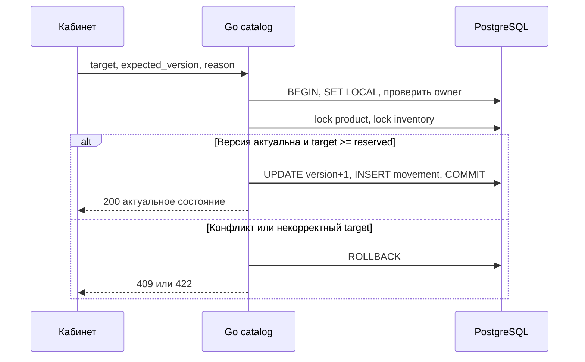

> Этап10Б: [Inventory Freshness Policy](INVENTORY_FRESHNESS_POLICY.md) применяется в общем customer/agent/order/outbox слое. Устаревание не обнуляет stock; reserve требует FRESH.

> Актуализация10А: Excel обновляет тот же on-hand под source policy, не меняет reserved и не снижает stock ниже резерва; существующие reserve/release/consume сохранены. См. CATALOG_SOURCE_POLICY.md и STAGE_10A_REPORT.md.

# Склад — этап 4

Один склад на организацию, целые единицы. Inventory создаётся автоматически с variant. Primary key `(organization_id,variant_id)`, составной FK к variant. `quantity_on_hand INTEGER` 0–1 000 000 000, `quantity_reserved INTEGER` default 0, CHECK 0≤reserved≤on_hand. `available=on_hand-reserved` вычисляется, не отдельная изменяемая колонка. Version BIGINT>0, updated_at timestamptz.

Public reserve/release отсутствуют. Резерв будущих заявок создаётся только после подтверждения сотрудником, в будущем отдельном transactional Orders/Inventory service. Текущий catalog.Adjust — внутренняя граница мутаций для HTTP; не использовать прямые UPDATE в будущих доменах и не добавлять reserve к JSON request. Конкурентный резерв должен блокировать те же inventory rows и увеличивать version, проверять available, писать movement в той же транзакции. Для нескольких вариантов соблюдать стабильный порядок блокировок. На этом этапе такой резерв не реализован и не заявляется проверенным.

## API

O = `/api/v1/organizations/{id}`:

- GET O/inventory: items с вариантом/SKU/товаром, on_hand/reserved/available/version; page/page_size.
- POST O/inventory/adjustments: `{variant_id,quantity_on_hand,expected_version,reason}`. Owner/session/Origin/CSRF; target absolute quantity, не delta. Начальная установка — та же корректировка 0→target. Версия обязательна. Reason 1–500 символов.
- GET O/inventory/movements: история, новые первыми; page/page_size. Actor UUID, время UTC, reason, before/after/delta, inventory_version, SKU/название. В UI показана причина и actor; не собирать ПД в reason.

Алгоритм: BEGIN → SET LOCAL session/org → membership/owner → lock product (проверка не archived) → lock inventory FOR UPDATE → сравнить expected_version → проверить target≥reserved → conditional UPDATE version+1 → INSERT movement → COMMIT. Все ошибки откатывают изменение и историю. Product lock согласует архив/публикацию/варианты; сериализует корректировки разных вариантов одного товара — приемлемо для пилота, оценить contention перед масштабированием.

Две вкладки с одной версией: одна получает 200, другая 409 VERSION_CONFLICT. Не делать автоматический retry старого target и не подменять версию свежей без решения пользователя. Кнопка обновления перечитывает фактическое состояние; повторная осознанная корректировка использует новую version. Даже корректировка тем же количеством пишет сверку delta=0 и увеличивает version.

`inventory_movements`: UUID id, organization_id, variant_id compound FK, actor_id users FK RESTRICT, reason, quantity_before/after nonnegative, delta CHECK=after-before, inventory_version>1, created_at. Unique(org,variant,inventory_version) запрещает две записи одного изменения. Индекс(org,created_at DESC,id). Runtime имеет SELECT/INSERT, без UPDATE/DELETE; INSERT policy также actor_id=current_user_id(). Public API не удаляет данные. Retention/export требуют отдельного решения.

## Изоляция и проверки

Все пять catalog tables ENABLE/FORCE RLS, owner=aba_migrator. Read policy требует selected org + session membership; insert/update owner + WITH CHECK. Нет DELETE grants/policies. Global auth state неизменен. Составные FK запрещают чужой category/product/variant независимо от RLS; backend не возвращает тексты constraint errors. SET LOCAL сбрасывается при commit/rollback; каждая операция own transaction. [PostgreSQL RLS](https://www.postgresql.org/docs/18/ddl-rowsecurity.html) и [row locks](https://www.postgresql.org/docs/18/explicit-locking.html) подтверждают выбранный механизм, не заменяют фактические тесты.

Проверки: `sh scripts/check.sh`, `sh scripts/integration.sh`, `sh scripts/smoke-compose.sh`. Integration создаёт отдельную aba_test/tmpfs с safety marker, тестирует RLS/owner/member, две concurrent adjustments, запрет below reserved, audit, active-only reads, миграции up/down/repeat и регрессию identity. Browser проверяет две реальные вкладки, конфликт, историю, switching и XSS. Результаты — STAGE_4_REPORT.

Migration 00003 additive, readiness требует metadata3. Down только на пустом каталоге и исключительно в isolated test DB: guard отказывается при products/categories. Не запускать down рабочей БД. API/worker миграции самостоятельно не применяют.

Ограничения: updated_at показывает время записи, не факт физической сверки; внешние продажи могут устарить остаток. Нет автоматической freshness policy, нескольких складов, дробных количеств, списания/приёмки ERP, возвратов или резервирования через публичный API.

## Расширение этапа5

catalog.MoveOrderStock работает в общей order transaction: reserve/release/consume, version+1, immutable movements с reserved before/after/delta/order. Публичного reserve API нет; confirmed staff action только test org. manual_updated_at отдельно, backfill last adjustment; reserve не освежает ручную сверку. Точный текущий flow —ORDER_MANAGEMENT, TTL предложения5min/INVENTORY_FRESHNESS24h. В UI история показывает тип и резерв.
