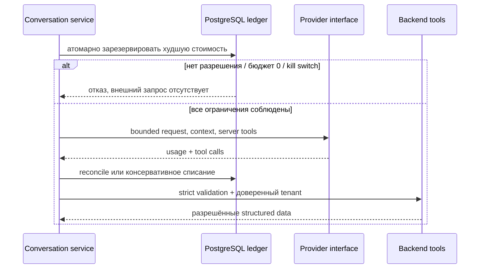

# Подготовка live LLM — этап 7

Состояние: **Mode A**, provider **NOT SELECTED**, активный `mock`, бюджет **0 RUB**. Live Telegram и LLM не запускались. Совместимый адаптер — поддержка протокола Chat Completions с function tools, а не выбор поставщика или утверждение тарифа.



`agent.Provider` сохранён. `Compatible` поддерживает tools, `max_completion_tokens`, `store:false`, отмену context, таймаут, ограниченный ответ 64 KiB и проверку каждого JSON аргумента. `Metered` выдаёт приватный context permit только после успешного reserve. Production-конструктор требует этот permit; локальные HTTP fixtures работают только внутри тестов.

Модель и URL задаются сервером: `LLM_MODEL`, `LLM_BASE_URL` (ровно HTTPS origin + `/v1`) и совпадающий `LLM_ALLOWED_BASE_URLS`. Никакой provider сейчас не выбран. IP literals, localhost, private/reserved DNS destinations, redirects и environment HTTP proxy запрещены. Dial выполняется на проверенный IP. API key только backend, не NEXT_PUBLIC и не ответы API.

Инструкции `electronics-v1` находятся в `internal/agent/orchestrator.go`. Каталог и сообщения недоверенные, tenant устанавливает backend. Модель не получает SQL, файловые инструменты или произвольный HTTP. Свободный текст модели не отображается как источник цены: backend формирует проверяемые карточки и шаблонный русский ответ. Поэтому поддержка естественного диалога ограничена; качество настоящей модели требует отдельной оценки.

По умолчанию retry=0. После согласования можно 0–2 повтора только для 429; Retry-After >2 секунд отклоняется, таймаут всей операции сохраняется. Сетевые ошибки/5xx не повторяются автоматически. После повторов usage считается неопределённым и списывается весь резерв. Невалидный tool/ошибка/лимит переводят обращение сотруднику. Заявка только после отдельного согласия на server quote, резерв только сотрудником.

## Конфигурация

Все параметры есть в `.env.example` и Compose. Сейчас:

```dotenv
LLM_PROVIDER=mock
LLM_ENABLE_LIVE=false
LLM_EXTERNAL_REQUESTS_AUTHORIZED=false
LLM_KILL_SWITCH=true
LLM_PLATFORM_BUDGET_MICRORUB=0
LLM_API_KEY=
LLM_MODEL=
LLM_BASE_URL=
LLM_ALLOWED_BASE_URLS=
LLM_RETRIES=0
```

Mock не ходит в сеть и не списывает деньги. Указание live provider при неполной конфигурации останавливает запуск с безопасной ошибкой; программный factory дополнительно возвращает Denied. Положительный env бюджет сам по себе не включает live: нужны отдельное DB approval оператором, org limits и live flag. Команд активации в автоматических тестах/старте нет.

Справочник протокола: [официальный API reference](https://developers.openai.com/api/reference/resources/chat/subresources/completions/methods/create). Для выбранного в будущем поставщика отдельно проверить поддерживаемую модель, tool calling, хранение данных и тариф; совместимость не гарантируется только названием API.
