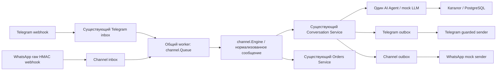

> 9А: добавлен Cloud API HTTP wire transport с отдельным template serializer и fail-closed SendAdmission. Runtime остаётся mock-only, бюджеты0; live financial admission/approved registry ещё не подключены. Подробности: [WHATSAPP_CLOUD_API_TRANSPORT](WHATSAPP_CLOUD_API_TRANSPORT.md), [9Б readiness](STAGE_9B_READINESS.md). Исторические ограничения ниже сохранены.

# Многоканальная архитектура — 8Б.2

Режим: offline/mock, реальные покупатели запрещены. LLM и WhatsApp budget0 RUB. Документ описывает текущую реализацию; не утверждает работоспособность настоящих API.

## Контракты и границы

`internal/channel/channel.go`: ChannelMessage (Go `Message`), tuple Principal, Adapter, Queue, capabilities, SendPolicy, monotonic receipt transitions. Поля сообщений: organization/integration/channel/external user/chat/message/conversation, direction, kind, text, attachment metadata, reply_to, provider/received timestamps, delivery status, correlation ID. Вложения не загружаются; URL пользователя не становится HTTP destination.

`Engine.Receive` — общая граница Telegram/WhatsApp → существующий `conversations.Service.Send`; unsupported передаёт человеку. `Engine.Action` — одна реализация offer/confirm для обоих каналов поверх существующего Orders Service. Staff/owner/customer не смешиваются.

Общий worker обходит `channel.Queue` каждого канала. Telegram сохраняет прежний защищённый sender и SQL-очереди: прямой вызов `Telegram.Adapter.Send` без приватного pinned guard запрещён; `Service.SendOne` создаёт bound adapter после admission и вызывает общий Send контракт. Это намеренное ограничение facade, а не разрешение обойти fencing через новый интерфейс. WhatsApp Adapter нормализует wire JSON; outbound разрешается SQL admission и mock transport. Нет второго агента, каталога или резервирования.

## Хранилище и совместимость

Миграция00010 добавляет `channel_integrations`, `channel_principals`, `channel_inbox`, `channel_outbox`, `channel_events`. Пока новый repository поддерживает только WhatsApp (`CHECK(channel='whatsapp')`). Telegram остаётся в `telegram_*`; физического объединения/копирования данных нет. Общие domain/worker контракты объединены, repositories двух каналов различаются. Единая таблица на все каналы не является условием общей бизнес-логики.

Все5 новых tenant-owned таблиц имеют ENABLE/FORCE RLS, владельца aba_migrator, составные org-FK. Runtime aba_app без BYPASSRLS, DDL и прямого queue write; секретные колонки не доступны SELECT. `channel_function_backup` — глобальная служебная таблица только для сохранения трёх определений SQL-функций при rollback. Она не содержит tenant-данных/секретов, runtime не имеет доступа.

`channel_scope` проверяет непредсказуемую действующую inbox capability, организацию, active integration, test org и конкретный conversation. `app.channel_cap` устанавливается только SET LOCAL внутри транзакции. TG capability не предоставляет доступа к WA и наоборот. Отдельные WhatsApp policies добавлены только на общие бизнес-таблицы; TG policies/таблицы не расширяются. Shared authorization helpers допускают оба scope, но не дают customer staff-переходы.

## Идентичность

Ключ: org + integration + channel + external user ID. WA `wa_id` и TG user ID — разные пространства. Одинаковые700 в двух организациях или каналах не означают одного человека. conversation customer UUID независим от users.id сотрудника. Автоматического объединения по номеру, имени или username нет.

## Границы этапа

Общий интерфейс не заменяет provider-specific security/очереди. Нет live WhatsApp transport, управления реальными шаблонами, media processing, объединения клиентов, нескольких номеров на org или production migration rollout. Обновление API/worker до schema10 выполняется вместе после явной миграции; старый бинарник с readiness9 не считается совместимым для бесшовного rolling deployment. Реальные данные и старые миграции сохраняются.
