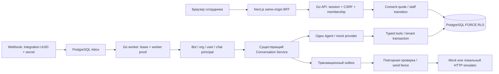

> Актуализация 8Д, фаза 2 (2026-10-21): установка 13 согласованных APK в отдельный Linux/amd64 образ выполнена. Go race, PostgreSQL integration с race, FORCE RLS на 32 таблицах, свежая Next.js production build и production browser E2E Telegram/WhatsApp — PASS. Подробности: [итог фазы 2](BUILD_ENVIRONMENT_PHASE_2_REPORT.md), [race](GO_RACE_FINAL_REPORT.md), [build](NEXTJS_PRODUCTION_BUILD_REPORT.md), [browser E2E](MULTICHANNEL_BROWSER_E2E_FINAL_REPORT.md). Исторические результаты ниже сохранены. Security: CONDITIONAL; открыто наблюдение E01 LOW (неустановленное происхождение пустых каталогов в build workspace). Оба live-канала NOT READY, бюджеты LLM/WhatsApp 0 RUB. Реальные API не вызывались; последующие установки и live-действия автоматически не разрешены.

# Актуальный статус 8В — 20.10.2026

**CONDITIONAL.** Новых CRITICAL0/HIGH0/OPEN findings0 в проверенной области; исторические A01/A02/A04 HIGH повторно проверены FIXED. Известные исправления прежних этапов сохранены; новые security fixes и миграции в8В не потребовались. Проверено32 tenant tables runtime-ролью, три магазина и два канала. Подробные доказательства/остаточные риски: [PRE_LIVE_SECURITY_REPORT](PRE_LIVE_SECURITY_REPORT.md).

Go race и fresh Next build **BLOCKED**, current SSR browser E2E **NOT RUN**. Это незакрытые gates, не отсутствие риска. Оба live readiness **NOT READY**, бюджеты0, реальные API не вызывались. Исторические счётчики и отчёты ниже сохранены, не подменяют результаты8В.

---

# Обновление аудита — 8Б.1, 18.10.2026

**Текущий статус:** CONDITIONAL; Telegram live NOT READY; бюджет0 RUB; external calls NONE в рамках этапа. Все три HIGH **FIXED**, повторно проверены. A09/A10 закрыты в новой миграции9, найден и исправлен A11 MEDIUM. Совокупно: CRITICAL0, HIGH3, FIXED11, OPEN0 известных находок; непройденные race/Next production/live проверки остаются отдельными gates, а не скрываются в этом счётчике.

| HIGH | Фактический статус | Повторное доказательство18.10 |
|---|---|---|
| A01 webhook Argon2 DoS | FIXED | `TestAuditWebhookRejectsMalformedBeforeDatabase`; дешёвый отказ до DB, unit PASS |
| A02 stale send после disconnect/handoff | FIXED | `handoff_cancels_queued_assistant`, `disconnect_cancels_already_claimed_send`, фактический advisory waiter; полный PG PASS |
| A04 неизвестный usage как0 | FIXED | `TestAuditIncompleteUsageIsUnknown`, `TestAuditZeroBudgetStopsActualAdapterTransport`; unit + concurrent ledger PASS |

A09: `process_dies_after_telegram_receipt_no_resend`, новый process resume, concurrent manual resolution/CSRF/stale cap, two-worker HTTP test. A10: crash subprocess после reserve и после mock response, новые процессы concurrent recover_once, полный conservative charge и idempotent settle. A11: HTTP500 с `error_code429` раньше запускал retry (RED); приоритет5xx теперь выше body, только HTTP429+code429 разрешают retry (GREEN). Severity MEDIUM, FIXED; residual внешний exactly-once всё ещё невозможен.

Реальные сроки/права/usage поставщиков не проверены; manual delivered — отметка сотрудника, не запрос Telegram; поздний UNKNOWN не возвращается в budget. Свежий inventory27 таблиц: [SECURITY_RLS_INVENTORY_8B1.json](SECURITY_RLS_INVENTORY_8B1.json). [Отчёт8Б.1](STAGE_8B1_REPORT.md) содержит команды, файлы, результаты/NOT RUN и остаточные ограничения.

---

## Историческая область 8А

Ниже сохранены исходные8А доказательства/ограничения. Счётчики и OPEN описания исходного снимка не заменяют актуальные статусы выше.

# Независимый аудит безопасности — этап 8А

Дата: 16.10.2026. Режим: offline/mock. **SECURITY STATUS: CONDITIONAL. TELEGRAM LIVE READINESS: NOT READY.**

Это проверка исходников и синтетического контура, не заключение о production-ready. Предыдущие отчёты использовались как карта, а не доказательство. Реальные Telegram/LLM не вызывались, ключи не предоставлены, бюджет 0 RUB. Критических находок: 0; HIGH: 3; исправлено: 8; открыто: 2 (MEDIUM). Отсутствие найденной критической ошибки не доказывает отсутствие всех уязвимостей.

## Область и метод

Прочитаны README, отчёты 2–7, архитектура, схема БД, AI Agent, Telegram, delivery, cost control, SECURITY и TENANT_ISOLATION. Проверены handlers, middleware, BFF, Go worker, SQL функций/политик, конфигурация и CI. На старте весь проект имел статус Git `??`; поэтому изменения сопоставлены с SHA-256 локального снимка до правок, а не с отсутствующим Git baseline. Документы и миграции 00001–00007 сохранены.

VERIFIED означает код + реально выполненный тест; PARTIALLY VERIFIED — есть код/ограниченная проверка; NOT VERIFIED — динамического доказательства нет; FAILED — воспроизведено нарушение до исправления. Существование теста само по себе не является VERIFIED.

## Компоненты и доверительные границы

| Механизм | Реализация и проверка | Вывод |
|---|---|---|
| Модульный монолит | `apps/api/internal/{auth,organizations,catalog,orders,conversations,agent,telegram,costcontrol}`; API и worker из общей базы | VERIFIED |
| Аутентификация | Argon2id, email sink, хеши сессий/CSRF, server-side dashboard guards, session/role API tests + браузер | VERIFIED в development; настоящий HTTPS/cookie Secure в браузере NOT RUN |
| Tenant context | `internal/tenancy.Begin`: `set_config(...,true)` внутри транзакции, session hash либо leased channel capability | VERIFIED, две организации и пул |
| Inbox/outbox | PostgreSQL функции claim/finish, leases, SKIP LOCKED, 5 попыток; отдельная отправка вне SQL-транзакции | VERIFIED; внешнее exactly-once отсутствует |
| LLM | interface Provider, Compatible, Metered, safe HTTP client, typed Runner; свободный ответ не публикуется как источник цен | VERIFIED локально; качество настоящей модели NOT VERIFIED |
| Бюджет | backend/SQL ledger, общий mutex, integer microRUB, reserve/settle, unknown usage оплачивается консервативно | VERIFIED; восстановление после полного падения — A10 |
| Telegram live | Guarded transport + ручные live-operations; startup/dashboard не вызывают API | VERIFIED запреты/mock; настоящий API NOT RUN |
| Наблюдаемость | структурированные correlation/request IDs, статусы очереди, агрегаты metrics | PARTIALLY VERIFIED: полноценный alerting/operator response не проверен |
| Retention | ограниченный test retention, erase/purge и FK-aware synthetic purge | VERIFIED тестами; правовая политика остаётся проектом |
| Redis, микросервисы, реальные Telegram/LLM, production | Не используются в этом этапе | Не являются реализованным пилотом |

## Находки

### A01 — HIGH — ресурсоёмкое хеширование на публичном webhook — FIXED

`internal/http/stage6.go: telegramWebhook` до правки создавал `auth.New` на каждый запрос. Конструктор вычисляет Argon2 dummy hash (64 MiB) до проверки JSON/секрета. Серия неаутентифицированных запросов занимала CPU/RAM и БД.

Воспроизведение: `internal/http/audit_test.go: TestAuditWebhookRejectsMalformedBeforeDatabase` с nil pool, неверным секретом/JSON/oversize: до правки ответы 500 вместо дешёвого отказа; после — 403/400/413 без обращения к БД. Исправление: limiter использует только pool, дешёвые проверки выполняются раньше rate-limit SQL. Остаточный риск: валидно сформированные атакующие запросы всё ещё расходуют ограниченный DB rate-limit ресурс; perimeter throttling для live не проверен.

### A02 — HIGH — отправка после disconnect/handoff — FIXED

Старый `telegram_disconnect` отменял только pending, но не sending. `SendOne` доверял результату прежнего claim; pending assistant мог уйти после передачи человеку.

Воспроизведение: `tests/integration/audit_test.go` — `handoff_cancels_queued_assistant`, `disconnect_cancels_already_claimed_send`. На исходной схеме 7 тесты падали; на 8 проходят. Миграция `00008_security_audit.sql` добавляет `telegram_prepare_send`, `telegram_control_fence` и сериализацию enqueue/disconnect. `send_guard.go` закрепляет соединение и session advisory lock на время HTTP, с гарантированным unlock либо закрытием соединения. `finish_send` выполняется на том же соединении. Тест `send_admission_serializes_disconnect` доказывает реальное ожидание через `pg_locks` и отсутствие открытой SQL-транзакции через runtime observer в `pg_stat_activity`.

Граница: операция, уже допущенная к отправке, может завершиться до возврата disconnect/handoff. Уже доставленное сообщение отозвать невозможно. Блокировка ограничена timeout. Kill switch не отзывает уже выполняющийся внешний HTTP.

### A03 — MEDIUM — crash после customer commit теряет ответ — FIXED

`conversations.Service.Send` раньше считал сохранённый customer message достаточным завершением idempotent запроса, даже если assistant не появился. Worker после перезапуска мог пометить inbox обработанным.

Тест `committed_message_crash_recovers_without_model_replay`: живой lease возвращает 409; после истечения — ровно одно уведомление и human handoff, без повторного вызова модели/изменяющих tools. Проверено RED на воспроизводящей исходную ветку копии и GREEN после исправления. Остаточный риск: восстановление консервативно передаёт человеку, а не автоматически повторяет генерацию.

### A04 — HIGH — неполный provider usage трактуется как нулевая стоимость — FIXED

`agent.Compatible.Generate` декодировал поля usage в int: `{}`/частичный usage становился известным нулём. Возврат резерва позволял недоучёт расходов.

`TestAuditIncompleteUsageIsUnknown` воспроизводил ошибку на локальном HTTP, 5 вариантов неполного usage. Теперь поля указатели, известность требует обоих достоверных значений; неизвестный usage оставляет консервативное списание в Metered/ledger. `TestAuditZeroBudgetStopsActualAdapterTransport` использует настоящий Compatible с counting RoundTripper и доказывает 0 вызовов транспорта при 0 RUB. Остаточный риск: оценка расходов не заменяет счёт провайдера.

### A05 — MEDIUM — повтор sendMessage после неоднозначного 5xx — FIXED

`telegram.HTTPTransport.call` раньше назначал retry для любого 5xx. Сервер мог уже отправить сообщение, а ответ потеряться. `TestAuditSend5xxIsUncertain` проверяет реальный POST/JSON, привязку chat_id и удаление parse_mode. Теперь sendMessage 5xx — uncertain без автоматического resend; 429 сохраняет bounded retry. `testTelegramHTTPAudit` проверяет uncertain и отсутствие повторной отправки после перезапуска Service. Остаточный риск: uncertain требует решения оператора, см. A09; exactly-once не обещается.

### A06 — LOW — JSON null в outbox вызывает panic — FIXED

`HTTPTransport.Send` записывал chat_id в nil map после JSON `null`. `TestAuditNullOutboxIsRejected` воспроизводил panic; теперь payload object проверяется и возвращается безопасная ошибка. Нормальный handler такой payload не формирует; защищено восстановление повреждённых/внутренних заданий.

### A07 — MEDIUM — readiness не замечает отключённый FORCE RLS — FIXED

`platform/db.Open/Ready` проверяли привилегии/владельца, но не ENABLE/FORCE флаги. Тест `readiness_fails_if_rls_is_disabled` на изолированной БД снимает RLS с messages и требует отказ; до правки readiness проходил. Теперь проверяются flags всех 25 известных tenant-таблиц, владельцы, aba_app, BYPASSRLS/superuser/replication/DDL и schema version 8. Остаточный риск: readiness — сигнал отказа, не замена миграционному контролю/мониторингу; новые таблицы требуют обновления списка и теста.

### A08 — MEDIUM — Telegram scope может переписать автора/служебные данные — FIXED

На схеме 7 runtime имел UPDATE всех колонок messages; scoped channel policy не ограничивала новые role/actor/data. При наличии внутреннего SQL-доступа с leased customer capability можно было подделать staff attribution или handoff_notice. Это не выдача owner/member, но нарушение целостности истории и границы служебных метаданных. Публичного SQL API нет.

`channel_cannot_rewrite_message_actor_or_control_metadata` до исправления получал успешный UPDATE; после — SQLSTATE 42501 для обеих подмен. Миграция 8 разрешает UPDATE лишь content/data/request_hash, а channel policy допускает только erasure (`content=''`, `data={}`, `request_hash IS NULL`). Tenant staff erasure сохранён. Остаточный риск: backend и SECURITY DEFINER функции остаются доверенной частью системы.

### A09 — MEDIUM — операторское восстановление uncertain delivery — FIXED (8Б.1)

Актуальное решение: `telegram_resolve_delivery`, version/idempotency/fence, staff/CSRF и append-only audit. Проверено `reliability_test.go` и текущими Chromium components. Подробности TELEGRAM_DELIVERY_RECOVERY.md. Далее сохранено исходное описание проблемы **на момент 8А**.

`telegram_claim_send` блокирует последующие сообщения за uncertain, чтобы не нарушить порядок и не сделать опасный повтор. Состояние видно в кабинете, но безопасного согласованного операторского workflow сверки/разблокировки нет. Локальные тесты подтверждают остановку повторов, не готовность оператора к реальному инциденту.

Воспроизведение: локальный sendMessage возвращает 500, затем restart Service: запрос не повторяется и uncertain остаётся. Последствие: диалог может остановиться. Для 8Б: добавить аудируемое решение оператора «доставлено / отказ от повторной отправки / явно одобренный повтор» с version/idempotency и защитой от дубля. Не менять статусы вручную в рабочей БД. До решения — блокер live.

### A10 — MEDIUM — зависший бюджет после аварии до settle — FIXED (8Б.1)

Актуальное решение: private settlement core, fixed5min stale recovery → UNKNOWN/full charge, автоматический worker tick и owner-only manual reconcile. Реальные subprocess crash/restart, конкурентные recovery и timeout прошли в PostgreSQL. Подробности LLM_BUDGET_RECOVERY.md. Далее сохранено исходное описание проблемы **на момент 8А**.

`agent.Metered.Generate` удерживает reservation, если settle не выполнен. Схема 7 сохраняет pending/active_calls; автоматического подтверждённого восстановления по usage провайдера нет. Статически подтверждено `metered.go` и `llm_reserve/llm_settle`; полный kill процесса между внешним ответом и settle NOT RUN. Перерасход предотвращается, но доступный бюджет/параллельные слоты могут остаться занятыми.

Для 8Б: консервативная идемпотентная сверка старых pending, операторская фиксация uncertain и тест crash-window. Нельзя автоматически возвращать деньги при неизвестном исходе. При текущем live disabled/0 RUB риск не активируется, но остаётся блокером live LLM.

## PostgreSQL: полный инвентарь

Снимок **фактического каталога после миграции 8**, без строк данных: [SECURITY_RLS_INVENTORY.json](SECURITY_RLS_INVENTORY.json). Он содержит все политики (command, roles, USING, WITH CHECK), FK, owner, flags и runtime table grants. `*` = ALL; `r/a/w/d` = SELECT/INSERT/UPDATE/DELETE. Отсутствие permissive policy и/или grant означает отказ, а не пропущенную защиту. UPDATE messages дополнительно ограничен по колонкам — table-level `update=false` в снимке не означает отсутствие erasure grants.

Для всех 25 tenant-таблиц: ENABLE=true, FORCE=true, owner=aba_migrator; runtime=aba_app не владелец и не BYPASSRLS. `organizations` — корневая tenant-сущность, её id заменяет organization_id. У membership нет публичного INSERT; назначение owner выполняет доверенная атомарная функция. Очереди/секреты не выдаются прямыми grants: proof-gated SECURITY DEFINER функции с фиксированным search_path и REVOKE PUBLIC являются дополнительной границей.

`testAuditRLS`: реальная чужая строка каждой таблицы; outsider runtime SELECT=0, INSERT=42501, UPDATE/DELETE=0 либо 42501. Владелец своей строки также не может заменить organization_id на чужой (WITH CHECK/column grants). Отдельно проверены channel capability, tenant pool cleanup, две организации и API 404. Это не защита от полного захвата runtime credentials/процесса: глобальный auth repository доверенный, как и backend SQL.

| Tenant-таблица | Политики (команда) | FK с tenant / особенность |
|---|---|---|
| `agent_metrics` | metric_update(w); migration_owner(*); scoped_read(r); metric_write(a) | Составных FK: 0; полные определения в JSON |
| `ai_settings` | migration_owner(*); scoped_read(r) | Составных FK: 0; полные определения в JSON |
| `ai_settings_events` | migration_owner(*); scoped_read(r) | Составных FK: 0; полные определения в JSON |
| `ai_usage` | migration_owner(*); tenant_read(r); tenant_insert(a); tenant_update(w); telegram_select(r); telegram_insert(a); telegram_update(w) | Составных FK: 0; полные определения в JSON |
| `conversation_events` | migration_owner(*); tenant_read(r); tenant_insert(a); telegram_read(r); telegram_insert(a) | Составных FK: 1; полные определения в JSON |
| `conversations` | migration_owner(*); tenant_read(r); tenant_insert(a); tenant_update(w); telegram_read(r); telegram_update(w) | Составных FK: 0; полные определения в JSON |
| `inventory` | migration_owner(*); tenant_read(r); tenant_insert(a); tenant_update(w); staff_stock(w); telegram_read(r) | Составных FK: 1; полные определения в JSON |
| `inventory_movements` | migration_owner(*); tenant_read(r); tenant_insert(a); staff_movements(a) | Составных FK: 2; полные определения в JSON |
| `llm_reservations` | migration_owner(*); scoped_read(r) | Составных FK: 1; полные определения в JSON |
| `llm_usage` | migration_owner(*); scoped_read(r) | Составных FK: 0; полные определения в JSON |
| `messages` | migration_owner(*); tenant_read(r); tenant_insert(a); tenant_update(w); telegram_read(r); telegram_insert(a); telegram_update(w) | Составных FK: 1; полные определения в JSON |
| `order_events` | migration_owner(*); tenant_read(r); tenant_insert(a); telegram_read(r); telegram_insert(a) | Составных FK: 1; полные определения в JSON |
| `order_items` | migration_owner(*); tenant_read(r); tenant_insert(a); telegram_read(r); telegram_insert(a) | Составных FK: 3; полные определения в JSON |
| `order_quotes` | telegram_update(w); migration_owner(*); tenant_read(r); tenant_insert(a); tenant_update(w); telegram_read(r); telegram_insert(a) | Составных FK: 1; полные определения в JSON |
| `orders` | telegram_read(r); migration_owner(*); tenant_read(r); tenant_insert(a); tenant_update(w); telegram_insert(a); telegram_update(w) | Составных FK: 1; полные определения в JSON |
| `organization_members` | migration_owner(*); membership_read(r) | Составных FK: 0; полные определения в JSON |
| `organizations` | migration_owner(*); tenant_read(r); tenant_update(w) | Составных FK: 0; полные определения в JSON |
| `product_categories` | migration_owner(*); tenant_read(r); tenant_insert(a); tenant_update(w) | Составных FK: 0; полные определения в JSON |
| `product_variants` | migration_owner(*); tenant_read(r); tenant_insert(a); tenant_update(w); telegram_read(r) | Составных FK: 1; полные определения в JSON |
| `products` | migration_owner(*); tenant_read(r); tenant_insert(a); tenant_update(w); telegram_read(r) | Составных FK: 1; полные определения в JSON |
| `telegram_events` | owner_read(r); migration_owner(*); owner_insert(a) | Составных FK: 1; полные определения в JSON |
| `telegram_inbox` | migration_owner(*); staff_read(r); owner_inject(a) | Составных FK: 2; полные определения в JSON |
| `telegram_integrations` | migration_owner(*); staff_read(r); owner_insert(a); owner_update(w) | Составных FK: 0; полные определения в JSON |
| `telegram_outbox` | migration_owner(*); staff_read(r); channel_outbox_read(r); channel_outbox(a); staff_outbox(a) | Составных FK: 2; полные определения в JSON |
| `telegram_principals` | staff_read(r); migration_owner(*); channel_principal(r) | Составных FK: 2; полные определения в JSON |

Глобальные таблицы без tenant RLS:

- `test_safety`: только изолированный тестовый маркер, не production entity.
- `goose_db_version`: журнал миграций; runtime без записи.
- `service_metadata`: schema/readiness metadata.
- `users`: глобальная идентичность пользователя до выбора организации.
- `email_verification_tokens`: одноразовые токены глобальной идентичности.
- `auth_rate_limits`: общесистемные лимиты, в том числе до входа.
- `email_outbox`: служебная очередь подтверждения email; зашифрованные payload.
- `sessions`: глобальная аутентификация; hash/session функции, не tenant entity.
- `llm_platform_budget`: единственный платформенный бюджет; runtime без прямых изменений, проверяемые функции.

## Telegram: доказательства и пределы

- `http/stage6.go:telegramWebhook`: лимит 16 KiB, typed JSON, reject trailing JSON, обязательный update_id и 43-char secret; 415/400/413/422/403/503, 200 только после durable ingress. Не вызывает Agent/Telegram из handler. SQL `telegram_ingress` связывает hash секрета именно с integration UUID, active/test org; чужой UUID с чужим секретом отклоняется.
- `telegram/types.go`, `service.go:Ingress`, `config/telegram.go:Allowed`, SQL principal/claim: private chat, user ID/chat ID, bot integration и organization; username не авторизация. Telegram capability не staff session и не membership. Allowlist проверяется до создания principal/conversation и повторно перед send. Mock без allowlist разрешает только синтетические сценарии, live требует список.
- Уникальный `(integration_id,update_id)` предотвращает повтор; staff/quote callbacks idempotent. Очередь последовательна **по надёжному времени поступления**, не по будущим ещё не пришедшим update_id. Ранее не встречавшийся update с меньшим numeric ID принимается в порядке поступления; защиты quote expiry/idempotency не заменяют сортировку сети. Тест `out_of_order_ids_follow_durable_arrival_and_single_lease` проверяет эту фактическую семантику; нельзя обещать числовую сортировку без ожидания пропущенных updates.
- Inbox lease восстановления и SKIP LOCKED проверены конкурентными calls. Outbox attempts bounded, backoff capped; 429 retry, timeout/5xx uncertain. Потеря worker после отправки и до фиксации не даёт exactly-once; истёкший sending становится uncertain. Disconnect отменяет pending/sending и processing inbox; повторная проверка admission защищает устаревший claim.
- После handoff прекращены новые autoanswers и отменены queued assistant. Безопасное handoff notice — серверная метка, не инструкция из каталога. Staff message требует existing authenticated order-access permission. Resume — явное действие сотрудника.

## Заявки и AI

`orders.Service.PrepareQuote/CreateRequest/Change` и `lockCatalog`: проверяемое согласие на quote с expires_at, integer price snapshots, повторная проверка current active/price/stock; сортированный порядок product/inventory row locks, transactional stock movement/status/event. `stage5_test.go` реально проверяет две конкурентные заявки на последнюю единицу, stale price, insufficient stock, cancel/complete exactly once, чужие variant и невозможность reserve из tools. Telegram callback подтверждает конкретную quote и principal, а не слово «да» или ответ модели. Тестовый контур не затрагивает ordinary organization stock.

`agent/tools.go:Runner.Execute` разрешает только известные схемы/типы, не даёт SQL/HTTP/file capabilities и не принимает tenant из tool args. `orchestrator.go:Run` ограничивает историю, размер результата, iteration/tool budget; пользовательские/catalog данные недоверенны. `platform/network` отвергает private IP/redirect/proxy SSRF; base URL задаёт backend allowlist. Локальные injection cases доказывают детерминированные запреты, **не качество реальной модели**. API key остаётся backend-only; free-form model answer не выдаётся как достоверные цены/наличие.

`costcontrol.Service.Estimate/Reserve/Settle`, SQL `llm_reserve/llm_settle`: положительные тарифы, ограниченные целые значения, проверка platform cap/kill switch до вызова, owner-only settings, сериализация платформенной строки и лимитов организации/диалога. Неверный/отсутствующий usage не равен бесплатному запросу. Ошибка провайдера учитывается консервативно: резерв преобразуется в расход/uncertain, а не безусловно возвращается. A10 отдельно описывает случай потери самого settle.

## Frontend/BFF и секреты

`apps/web/src/app/api/[...path]/route.ts`: allowlist путей/методов, фиксированный backend URL, forwarded только необходимые headers/cookies, body cap 64 KiB, no-store, no redirects, timeout. Dashboard защищён серверной session check; org из браузера повторно проверяет backend. Мутации требуют Origin+double-submit CSRF, backend roles; скрытие UI не считается авторизацией. Браузерная регрессия проверила XSS-имя, отсутствие localStorage auth, HttpOnly/SameSite, org switching/409, logout/redirect, live-operation 403 и zero-budget UI. Secure cookies в реальном HTTPS NOT RUN.

Локальный redacted scan проверил 249 файлов (исходники, docs, конфигурация и имеющиеся `.next/static`), token/key/private-key patterns и точные длинные значения секретных полей локального `.env`, не выводя значения: совпадений нет. `.env` не имеет group/other permissions и игнорируется Git; `.local` также игнорируется. Локальные ключи не попадали в отчёты. Это ограниченный сигнатурный анализ, не доказательство происхождения каждого литерала. `router_test` и `stage6_test` проверяют отсутствие secret/переписок в logs/API; provider tests — redacted errors. SQL statement logs отдельного тестового Postgres не равны безопасной production logging policy.

## Offline-среда и воспроизводимость

Сетевая изоляция проверялась фактически: локальный UNIX Docker endpoint, `pull_policy:never`, `--pull never --no-build`, `internal:true`, отсутствие default route в `/proc/net/route`, DNS loopback, пустые proxy env, нет host ports/host networking/socket mount, telemetry выключена. Unit-контейнеры также запускались с `--network=none`. HTTP emulator принимает только loopback; неожиданный provider host отвергается тестовым transport. Проверять внешний доступ пробным запросом в интернет запрещено и не выполнялось.

Изоляция относится к созданным audit-контейнерам/запущенным командам. Глобальный firewall хоста не доказан, сторонние существовавшие процессы не контролировались. macOS sandbox profile не удалось применить (`Operation not permitted`); права не повышались. Поэтому динамические host-команды с потенциальной сетью не запускались. Установленные Go modules читались read-only с GOPROXY=off/GOSUMDB=off/GOTOOLCHAIN=local/GOTELEMETRY=off; Node tools вызывались напрямую из установленных node_modules, без npm install/npx/download.

Полные результаты и ограничения: [STAGE_8A_REPORT.md](STAGE_8A_REPORT.md). Live/API/production, CVE feeds, race без локального C compiler и свежая Linux frontend сборка без native dependencies остаются NOT RUN. Любая следующая готовность должна учитывать эти пробелы и A09/A10.

## Ограничение evaluation suite

`agent/evaluation_test.go:TestEvaluationSafetyGuards` действительно выполняет 30+ сценариев, но проверяет mock tool schema/no implicit mutation/live gate, а не все описанные natural-language expectations. Их semantic/NLP correctness остаётся NOT VERIFIED/NOT RUN. Полный business flow подтверждается отдельными PG/browser/HTTP тестами, не одним успешным HTTP ответом и не названием evaluation case.

## Дополнение8Б.2 — многоканальный scope, не новый полный независимый аудит

Три ранее закрытые HIGH-находки и A09/A10 проверяются прежними regression tests в расширенном suite; они не считаются доказательством безопасности всего нового кода. Миграция10 добавляет5 tenant tables с FORCE RLS; audit inventory теперь32 таблицы. Новый WhatsApp scope не даёт TG access, проверяются чужие org и rollback контекста пула. HMAC/allowlist/phone routing/zero budget/UNKNOWN и реальный process exit после loopback receipt покрываются новыми тестами. Проблемы, найденные во время реализации (nil error mapping, search_path при клонировании policy, PL/pgSQL alias ambiguity), исправлены до итогового прогона; это не объявляется отдельной подтверждённой production-уязвимостью.

Остаточные ограничения: реальный Meta transport/rotation/current policy не проверены/не включены; fresh Next build и Go race недоступны локально. Перед live требуется отдельная ревизия migration10 security-definer функций/policies и разрешения оператора. Полный статус/доказательства — STAGE_8B2_REPORT. Production-ready не заявляется.
