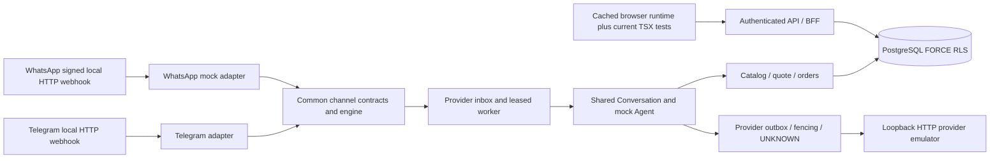

# Этап 8В — Multichannel Pre-Live Stabilization & Full Offline E2E

Дата: 20.10.2026. Работа выполнена в существующем репозитории, offline/mock.

| Итог | Статус |
|---|---|
| SECURITY STATUS | **CONDITIONAL** |
| TELEGRAM OFFLINE E2E | **PASS backend; current SSR browser NOT RUN** |
| WHATSAPP OFFLINE E2E | **PASS backend; current SSR browser NOT RUN** |
| TELEGRAM LIVE READINESS | **NOT READY** |
| WHATSAPP LIVE READINESS | **NOT READY** |
| GO RACE DETECTOR | **BLOCKED** |
| NEXT.JS PRODUCTION BUILD | **BLOCKED** |
| FORCE RLS | **PASS32 tenant tables** |
| Новые CRITICAL / HIGH / OPEN findings | **0 / 0 / 0 в проверенной области** |
| Исторические HIGH | **3 FIXED**, повторные regressions PASS |
| LLM BUDGET / WHATSAPP BUDGET | **0 RUB / 0 RUB** |
| EXTERNAL CALLS | **NONE для выполненных действий этапа** |
| NEW MIGRATIONS | **NONE**, 00001–00010 сохранены |

Полная pre-live готовность **не достигнута**: race, свежая Next production build и полный current SSR browser E2E остаются открытыми gates. Не считать их PASS. Система не объявляется готовой к настоящим клиентам.

## Инвентаризация и план

Прочитаны README, отчёты8А/8Б.1/8Б.2, security/multichannel/delivery/WA policy/TG и LLM recovery/readiness документы; проверены handlers, worker, channel adapters, общие Conversation/AI/Catalog/Orders, auth/BFF, migrations и tests. Все перечисленные пользователем основные файлы найдены. Последняя фактическая миграция10, common Channel Layer и WA mock-only repository существуют. До изменений Git working tree целиком untracked; commit baseline отсутствует, поэтому сравнение сделано с локальным SHA-256 snapshot, без git add/commit.

План реализован: независимая перепроверка окружения → строгий изолированный offline Compose → новые3×2 E2E и негативные/конкурентные tests → native build/race preflight → runtime/browser regression и restart → отчёты. Предыдущие PASS не использовались вместо запуска. Первые integration прогоны PASS18.382s/33.076s, после расширения22.947s; финальный с price/stock conflicts **17.538s**. Существенное уточнение исходного состояния: на macOS есть clang/gcc и Darwin native modules; их отсутствие относится к выбранным безопасно изолированным Linux runners.

## Архитектура и изменения

Бизнес-модули, API/worker entrypoints, публичные контракты и migrations не переписаны. Telegram storage сохранён; WA channel_* использует те же бизнес-сервисы. Изменения этапа — тестовое доказательство и изолированный стенд, не новый live функционал. Подтверждённых новых CRITICAL/HIGH ошибок, требующих application fix/миграции11, не обнаружено. Отсутствие находок ограничено покрытием.

Новый `testPreliveMatrix` создаёт3 независимых магазина A/B/C, по owner+staff, own catalog/price/stock, TG+WA integrations/principals/conversations/orders. customer_id использует существующие principal IDs, отдельная новая customers таблица не добавляется. Одинаковые external IDs между магазинами и каналами не объединяются.

Реальные HTTP handlers и wire адаптеры работают с loopback emulator, реальная PostgreSQL — с runtime aba_app. Проверены exact tenant variant/price, absent product, quote-bound consent, duplicate update/confirm, no early reserve, staff reject, last-unit concurrent confirm, idempotent cancel, price change и stock0 до staff decision. Три пары A→B→C проверяют API404/service/SQL denial. Новые webhook negatives проверяют secret/HMAC, изменённое WA тело, wrong Phone ID, unknown integration/user, oversize413, body organization spoof и disabled integration. WA wrong worker proof не получает job.

Дополнительный WA retry subtest:5 реальных SQL claims/finish, backoff blocks immediate reclaim, fifth attempt→failed, stale capabilities не завершают новую попытку,5 sending audit events, отсутствие шестого send. Process crash после mock provider receipt и UNKNOWN/no-resend/manual resolution/two worker проверены выполненными existing recovery suites обоих каналов. Таймаут не считается доказательством отсутствия доставки; exactly-once не обещается.

## Проверки и фактические команды

Base prefix `docker compose --env-file .local/audit8v/compose.env -f infrastructure/compose.stabilization.yml`. В env только путь к уже существующему cache, test credentials синтетические в isolated config. См. [BUILD_READINESS_REPORT](BUILD_READINESS_REPORT.md) для prerequisites и точных команд.

| Проверка | Результат | Доказательство / ограничение |
|---|---|---|
| Compose config, включая smoke overlay | PASS | `config --quiet` exit0 |
| Go formatting | PASS | gofmt без вывода; общий go service также проверяет cmd/internal/tests |
| Go unit tests | PASS | `run --rm go`: `go test -count=1 ./...`, exit0 |
| Go vet | PASS | тот же service `go vet ./...` exit0 |
| Go production binaries | PASS | свежие API/worker/migrate/healthcheck; SHA manifest в `.local/audit8v/artifacts/build-manifest.json`; smoke использует их |
| Go race | BLOCKED | `run --rm race`, CGO1, exit1: `C compiler gcc not found`; тесты не выполнились |
| PostgreSQL integration | PASS | `run --rm integration`, финальный17.538s; full log `.local/audit8v/artifacts/integration.log` |
| FORCE RLS/runtime role | PASS32 | `testAuditRLS`: actual foreign rows и negative operations под aba_app; metadata evidence JSON |
| Migration clean/repeat/concurrent/up/down/upgrade | PASS | isolated aba_test, existing suite;10→9→10 сохраняет TG snapshot, populated destructive rollback rejected |
| LLM zero budget/ledger recovery | PASS | unit transport counter0, PG concurrency/unknown/conservative charge/idempotency; no actual LLM |
| WhatsApp zero budget/live gates/window | PASS | config/policy/DB constraints и HTTP mock tests; будущий paid ledger не заявляется реализованным |
| Telegram+WA backend E2E | PASS | 3×2 matrix + regression, actual local HTTP sendsTG37/WA37 |
| Frontend lint / typecheck | PASS | `run --rm web-check`, ESLint и tsc noEmit exit0 |
| OpenAPI | PASS | `check-openapi.mjs` schema + actual endpoint set; контракт не менялся |
| Fresh Next production build | BLOCKED | Native preflight MISSING Linux SWC16.4.0/Oxide4.3.3; Next build не запущен во избежание download |
| Current TSX/browser + current BFF contract | PASS ограниченный | `test-multichannel-components.cjs`, `test-recovery-components.cjs`; local Chromium, owner/409/CSRF/tenant/XSS/UNKNOWN |
| Cached-web browser regression | PASS ограниченный |5 passed48.7s; actual registration/email/session/catalog/orders/mockTG/AI settings/redirect/errors |
| Backend-down browser | PASS | отдельно после фактического stop test API:1 passed8.2s; первоначальный intentional skip не считается PASS |
| Полный current Next SSR E2E, включая WA screens | NOT RUN | Нет свежей production build; cached stage7 web её не заменяет |
| Production-like smoke | PASS backend / cached web | healthy API/PG/web/Mailpit, worker running; live200/ready200/status200 |
| PostgreSQL restart | PASS isolated | PG stop: live200/ready503; start: ready200, schema10 и synthetic orders сохранились |
| Graceful stop/restart | PASS API/worker | оба exit0, затем успешный restart |
| Secrets scan | PASS в ограниченной области | См. ниже; не абсолютная гарантия |
| Real TG/Meta/LLM, TLS/webhook internet, pricing | NOT RUN | Запрещены пользователем, ни одного вызова |

Helper tests `TestRecoveryCrashHelper` и `TestWhatsAppCrashHelper` в верхнем списке имеют SKIP, поскольку запускаются только родительскими тестами в дочерних процессах; родительские crash assertions реально выполнены. Отдельный ошибочно вызванный backend-down run без нужного env также skipped и не засчитан.

Технические неуспешные команды не скрыты: race exit1 — toolchain BLOCKED; gofmt внутри read-only mount отказал, затем корректно выполнен локальный gofmt; несколько составных shell-команд Docker получили sandbox socket denial и были повторены прямыми разрешёнными командами. Повышения прав не было. Это не исправление приложения заглушками.

## Безопасность и сохранность

Исполняемые тесты — cached images pull never, internal network, no default IPv4 route, loopback DNS, empty proxy env, no host ports/Docker socket. Provider requests принудительно localhost. Отсутствие внешних вызовов относится к действиям этапа, не ко всем процессам компьютера; сеть хоста глобально заблокированной не объявляется. Запросы официальной документации/обновлений/telemetry/download/install не выполнялись.

В `.env` подтверждены mock LLM/TG, live/external=false, kill=true, platform budget0. WA flags не заданы — валидированные defaults false/0; тестовый smoke задаёт их явно. Настройки/секреты пользовательского env не изменялись и не выводились. Только synthetic fixtures разрешают mock sending внутри isolated test integrations, без возможности настоящего провайдера.

Ограниченный redacted scan: **697** файлов source/доступных bundle, исключены deps/cache и файлы>8MB;0 token/private-key signatures/exact long local-env secret matches. Вывод содержит только пути/типы, не значения. Новый captured-log тест также проверяет отсутствие webhook/session/WA credential strings. SHA-256 migrations1–10 совпадает с исходным snapshot; dependency/lockfiles не менялись, пользовательские файлы не удалялись.

Исходный `ai-business-assistant-*` stack остался healthy с прежним uptime6–7дней, его БД не мигрировалась и сервисы не останавливались. Разрушающие проверки выполнены только в aba-audit8v/aba-audit8v-smoke. После проверок удалены только собственные тестовые контейнеры/сети и synthetic smoke volume; ignored logs/build artifacts сохранены.

## Критерии A–T

| Критерий | Статус | Предел |
|---|---|---|
| A Telegram offline E2E | PASS backend | Pipeline+API; новый SSR UI отдельно NOT RUN |
| B WhatsApp offline E2E | PASS backend | Pipeline+API; новый SSR UI отдельно NOT RUN |
| C Common Channel Layer | PASS | Оба используют общий Engine/Conversation/AI/Catalog/Orders |
| D own catalog | PASS | Exact price/variant3 shops |
| E explicit consent | PASS | Quote-bound action; no order before consent; duplicate one order |
| F staff reserve | PASS | No early reserve, reject, concurrent confirm/cancel |
| G tenant isolation | PASS | A/B/C +32-table runtime RLS |
| H channel principal | PASS | Same external ID не объединяется |
| I Telegram auth | PASS offline | Negative secret/route/allowlist/limits |
| J WhatsApp auth | PASS offline | HMAC/raw-body/Phone ID/replay |
| K recovery | PASS в сценариях | Crash/restart/concurrency tests, не все возможные failure boundaries |
| L UNKNOWN safe | PASS | No automatic resend; manual versioned resolution |
| M WA policy | PASS offline | Closed window→needs template, no paid/live send; current official policy NOT RUN |
| N LLM budget0 | PASS | Actual adapter transport counter0 при запрете |
| O WhatsApp budget0 | PASS | Live transport/paid operations blocked, CHECK0 |
| P race | BLOCKED | Isolated runner lacks compiler |
| Q Next production build | BLOCKED | Linux native dependencies unavailable |
| R full frontend browser E2E | NOT RUN полностью | Cached regression и current component/BFF PASS только в их области |
| S no known open CRITICAL/HIGH | PASS в области аудита | Новых0, исторические3FIXED; не доказательство отсутствия неизвестных ошибок |
| T no external/commit/push/deployment | PASS | Offline isolation, no privilege escalation, no external operations |

## Изменённые файлы

14 файлов относительно SHA snapshot:5 изменены,9 созданы. Изменены:

- `README.md` — актуальный conditional status и ссылки.
- `apps/api/tests/integration/database_test.go` — запуск новой matrix.
- `docs/SECURITY_AUDIT_REPORT.md` — актуальные scope/gates, история сохранена.
- `docs/TELEGRAM_LIVE_READINESS_CHECKLIST.md`.
- `docs/WHATSAPP_LIVE_READINESS_CHECKLIST.md`.

Созданы:

- `apps/api/tests/integration/prelive_matrix_test.go`.
- `infrastructure/compose.stabilization.yml`.
- `infrastructure/compose.stabilization-smoke.yml`.
- `docs/STAGE_8V_REPORT.md`.
- `docs/MULTICHANNEL_E2E_TEST_REPORT.md`.
- `docs/PRE_LIVE_SECURITY_REPORT.md`.
- `docs/BUILD_READINESS_REPORT.md`.
- `docs/PILOT_TEST_PLAN.md`.
- `docs/SECURITY_RLS_INVENTORY_8V.json` — actual global+tenant metadata, tenant count32.

Новых migrations/API endpoints/изменений OpenAPI нет. Бизнес-данные/схема пользователя сохранены.

## Оставшиеся blockers и следующий шаг

1. Предоставить заранее подготовленную изолированную offline C toolchain; выполнить race, исправить при обнаружении гонок.
2. Предоставить подходящие offline Linux native frontend dependencies; fresh production build и запуск именно её artifacts.
3. Полный browser E2E текущих Telegram/WA pages, ролей/организаций/ошибок/заявок/stock на свежей сборке.
4. WA live transport отсутствует; до реального Meta-теста реализовать guarded transport и проверить актуальные официальные policy/version/pricing после отдельного разрешения на документацию.
5. Утвердить synthetic participants/data policy/HTTPS/allowlist и отдельные provider operations. Ни одного разрешения сейчас не запрашивается; LLM budget не увеличивать.

Будущие getMe/setWebhook/getWebhookInfo/deleteWebhook/sendMessage, Meta App/WABA/test number/tokens/subscription/messages/pricing verification, public HTTPS и любые внешние действия требуют нового явного разрешения по каждому каналу. План действий и остановки: [PILOT_TEST_PLAN](PILOT_TEST_PLAN.md). До этого Telegram/WhatsApp остаются NOT READY, live off, оба budgets0. Работа этапа остановлена после локальных проверок и отчётов; следующие этапы автоматически не начаты.
