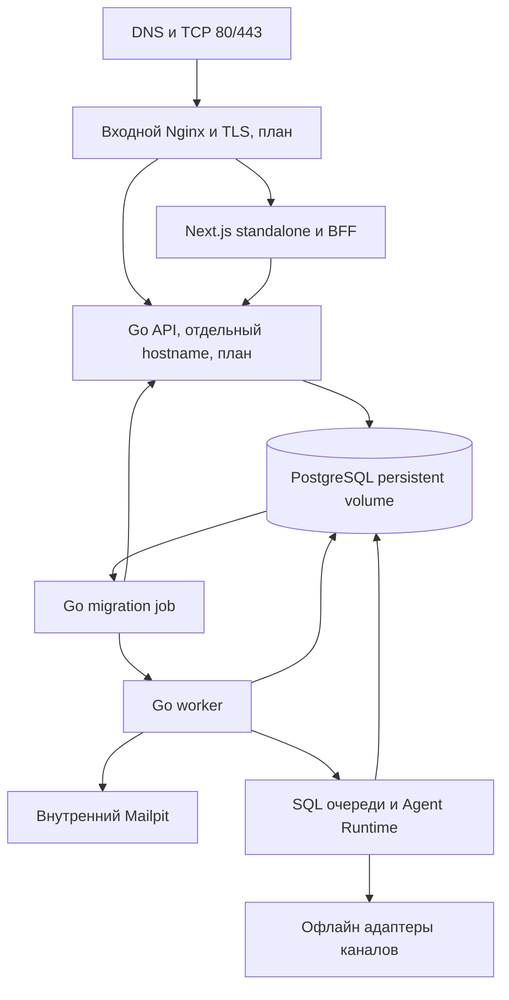

# AI Business Assistant — staging deployment

## Статус на 2026-11-22

| Критерий | Результат |
| --- | --- |
| CODE COMPLETE | PASS для Linux release tooling, `APP_ENV=staging`, тестовых сценариев и неизменяемого пакета. |
| DEPLOYED | Nginx TLS ingress, Docker и host security работают. Запуск контейнеров проекта `aba-private-staging` ожидает завершения проверок и GO по точному manifest. |
| RUNTIME VERIFIED | PASS для базовой изолированной PostgreSQL интеграции и conversational orchestration suite. Приёмка основного staging остаётся открытой. |
| SECURITY VERIFIED | PASS для SSH key-only, ограниченного sudo, UFW, изоляции Compose по preflight и TLS edge. Серверные проверки ролей и web session после запуска остаются открытыми. |
| BACKUP VERIFIED | PASS в отдельной VPS rehearsal с PostgreSQL 18.7. Backup и restore основной staging базы пока NOT RUN. |
| LIVE INTEGRATIONS VERIFIED | NOT RUN. Все внешние доставки запрещены, бюджеты 0 ₽. |
| PRODUCTION READY | NO-GO. E01 остаётся OPEN. |

## Источник и VPS

GitHub подтвердил `a216246e5840eb9c7c49945bfa5220f13d9cba38` на `work/stage-2-6-4-conversational-orchestration` и его происхождение от checkpoint `43d1aa888f956c3475fc35487b540f0d5462d965`. Изменения staging ведутся в `work/staging-deployment`. Выпуск provisional candidate не изменял опубликованный baseline.

На `2.26.1.63` инвентаризация подтвердила Ubuntu 24.04.4 LTS, Linux 6.8.0-149, 4 vCPU Ryzen 9 5950X, 7.8 GiB RAM, swap 511 MiB, диск 150 GB и 137 GiB свободного места перед установкой. VPS видит виртуальный диск `vda`; физический тип накопителя из VPS не подтверждён. Системное время синхронизировано. До установки слушали только OpenSSH снаружи и systemd-resolved на loopback; каталогов Docker/PostgreSQL и следов прикладных сервисов не обнаружено.

Docker Engine 29.10.0 из официального репозитория, Compose 5.8.0, Ubuntu Nginx `1.24.0-2ubuntu7.21`, Certbot 2.9.0. Из Docker Registry получены и закреплены по immutable IDs Linux/amd64 Go 1.26.11, PostgreSQL 18.7, внутренний Nginx 1.30.7, Mailpit 1.34.0 и Node 24.21.0 из Playwright 1.64.0. Next.js 16.4.5 собран из lockfile. Пакеты контейнеров обновлены после проверки исправлений поставщиков. [PostgreSQL 18.7](https://www.postgresql.org/docs/18/release-18-7.html) · [Nginx advisories](https://nginx.org/en/security_advisories.html) · [Mailpit releases](https://github.com/axllent/mailpit/releases) · [Ubuntu Nginx backport](https://ubuntu.com/security/CVE-2026-118899)

Независимые сессии `aba-admin` и `root` по ключу прошли после reload. `aba-admin` имеет только ограниченные команды STATUS через sudo. Root key доступ сохранён для сопровождения. PasswordAuthentication и keyboard-interactive выключены. UFW разрешает публично только 22, 80 и 443, политика deny incoming/routed. У проекта отдельные файловые credentials и TLS CA. Контейнерные логи ограничены 10 MiB × 3 на сервис.

## DNS и публичные точки

Оба авторитетных сервера Mitelis вернули A `2.26.1.63` для `ai-business-store.com` и `api.ai-business-store.com`. AAAA и CAA не опубликованы. Let’s Encrypt выдал сертификат с обоими SAN до 2027-02-20 10:10:09 UTC. `certbot renew --dry-run` PASS, таймер активен. Оба HTTPS endpoint подтвердили доверенную цепочку и вернули 401 без Basic Auth. HTTP отдаёт 308, webhooks закрыты на ingress и вернули 404. Доступ к backend через защищённый ingress проверяется отдельно после старта приложения.

## Граф зависимостей

## Контур и данные

В Compose находятся PostgreSQL, мигратор, Go API, worker, Next.js, внутренний Nginx и Mailpit. Сохраняются PostgreSQL volume, внутренний DNS, внутренние порты 8443/8444, TLS до proxy и verify-full до PostgreSQL. PostgreSQL использует `aba_app` для runtime и `aba_migrator` для выполнения миграций. Лимит пула Go 5 на процесс, PostgreSQL 30 соединений и 512 MB shared buffers. На сервере Compose публикует ноль контейнерных портов. Все живые каналы остаются выключены.

`APP_ENV=staging` требует безопасные cookies, HTTPS origin, проверенный DB TLS и явные нулевые бюджеты и kill switches. Worker включает conversational orchestration через синтетический mock и имеющиеся SQL gate и approval. Production отклоняет mock LLM и Telegram и по умолчанию отключает соответствующие transports. Telegram/WhatsApp staging используют отдельные ключи шифрования. Instagram fixture ограничен отдельной тестовой БД и специальной сборкой. API edge закрывает публичный ingress webhooks.

Последняя миграция `00029_conversational_orchestration.sql`, ожидаемая схема 29 и 62 таблицы FORCE RLS. Registry содержит `customer`, `sales`, `product_inventory`, `marketing`, `finance`, `analytics`, `business_manager`. Источник и изолированные сценарии проверены в границах тестовых стендов. Статус всех семи агентов в основном проекте пока NOT RUN.

## Проверки и evidence

| Проверка | Статус |
| --- | --- |
| GitHub, VPS preflight, authoritative DNS, UFW и sudo | PASS. `vps-preflight.log`, `vps-firewall.log`, `vps-admin-sudo.log`. |
| SSH hardening | Первый FAIL из-за отображения OpenSSH `without-password` вместо ожидаемого `prohibit-password`. Проверка обоих вариантов, reload и независимый повторный вход PASS. |
| Nginx edge, ACME, TLS и renewal | PASS. `vps-edge-install.log`, `vps-public-edge.log`, `vps-certbot.log`, `vps-cert-renewal.log`. |
| Go unit/race/vet/build | PASS на Go 1.26.11 локально. Linux unit/vet/build также PASS. |
| Linux frontend, lint, typecheck, OpenAPI, Next proof и npm audit | PASS на чистом snapshot. Первый lint FAIL из-за AppleDouble `._*` при переносе с macOS. Сборка повторена в отдельном каталоге. Production dependency audit нашёл 0 уязвимостей. Общий audit прошёл порог high, зарегистрировал 11 moderate в dev-зависимостях. |
| Deployment Python и artifact guards | PASS. 35 тестов deployment, отдельные проверки readiness и artifact proof. |
| PostgreSQL и маршрутизация | PASS в выделенных `aba_test`: `TestDatabaseAndMigrations` повторён на 18.7, `TestConversationalIsolated` прошёл на 18.3 для трёх каналов. Изолированные пакеты проверяют tenant isolation, lease recovery и Human Approval. |
| Instagram | Первый отдельный запуск FAIL из-за пропуска пути к обычному worker. Повтор на 18.7 с двумя worker-бинарниками PASS. Обычная сборка сохранила запрет отправки. |
| Chromium | PASS, 5/5, включая регистрацию с Mailpit, сессию, каталог, заказы, mock Telegram, настройки AI и logout. Первые запуски блокировали права bind mounts и sandbox. Официальный Playwright seccomp profile использован только для непривилегированного тестового контейнера. Селекторы обновлены под текущие подписи и мобильный список. |
| Native package preflight | PASS. Кандидат `f5aa3539842be7b991d13e0e7bd6363a9685541ca2dec91c98679274435ad038`, report `/srv/aba/staging/reports/preflight-20261122.json`. |
| Immutable image smoke | PASS. Next image guard и `/login`, отказ API/worker при `APP_ENV=test` и `production`, `nginx -t` и Mailpit readiness под непривилегированными UID. |
| Backup/restore в отдельных проектах | PASS. Архив 843322 байта, TOC и SHA-256 проверены. На восстановленной PostgreSQL подтверждены схема 29, 62 FORCE RLS, 267 policies, ограниченная роль и отсутствие строк без tenant-контекста. |
| Приложение, worker, runtime monitoring и backup основного staging | NOT RUN до install. |
| Внешнее backup-хранилище | BLOCKED. Место назначения отсутствует. |

Команды, результаты и журналы находятся в [локальном индексе](../.local/staging-deployment/INDEX.md). Штатный `deploy.py install` проверяет owner GO, привязанный к точному manifest, проекту и миграциям. Это отдельный документ, ожидаемый с подтверждением владельца. Интеграции и клиентский пилот остаются выключены.

Снимок перед запуском показал 129 GiB свободного места и 7.1 GiB доступной RAM. `sysstat-collect.timer` активен. Замеры backlog, соединений, перезапусков и потребления сервисов запланированы для основного контура после install.
