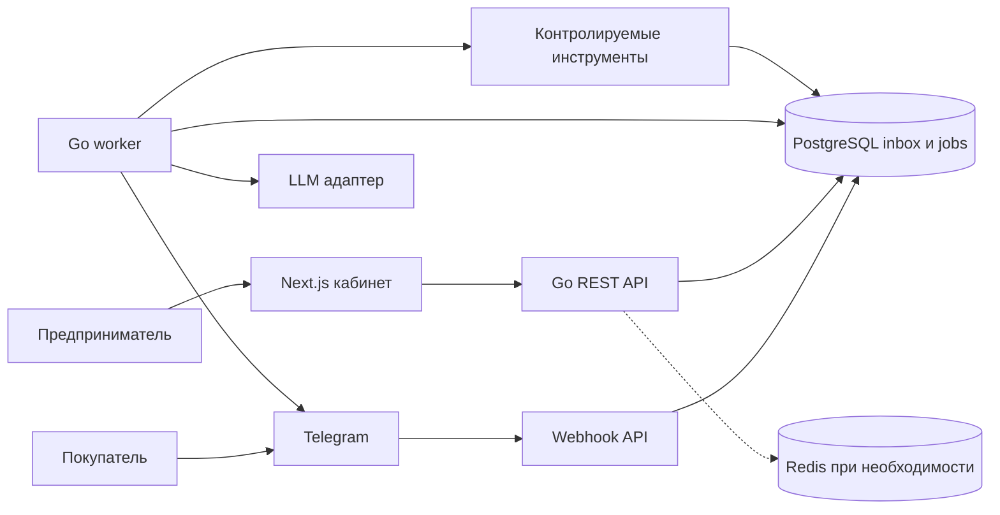

# Архитектура системы

> ТЗ № 5: реализованы каркас, auth, организации, каталог, склад и изолированный test workflow заявок/чата с FORCE RLS. Ниже — целевая архитектура; остальные бизнес-модули ещё не реализованы. Фактический запуск и проверки: [LOCAL_DEVELOPMENT](LOCAL_DEVELOPMENT.md).
## Подход и стек

Модульный монолит Go: HTTP API и worker — два процесса одной кодовой базы с общей схемой PostgreSQL. Прямые вызовы application-сервисов внутри монолита; фоновые действия через транзакционный outbox. Такой подход позволяет одному разработчику сопровождать транзакции и деплой без распределённых контрактов.

Go + REST + PostgreSQL сохраняются. Предлагаются `net/http`, pgx, sqlc для типизированных SQL, goose для миграций; их версии и актуальную совместимость выбрать при реализации. Next.js + TypeScript + Tailwind сохраняются: хороший кабинет, SSR не является требованием для закрытой части. Один origin через reverse proxy `/api` снижает сложность cookies/CORS. PostgreSQL FTS и нормализованный поиск модели/SKU достаточно для первого каталога. pg_trgm добавить только при необходимости поиска опечаток. Векторная БД не нужна для цен и остатков.

Redis предусмотрен для распределённого rate limiting и короткоживущего кэша; не источник истины, не обязательный брокер. В первом MVP допустим rate limit в PostgreSQL для небольшого пилота либо Redis, если появятся несколько API-процессов. Очередь `jobs` в PostgreSQL уменьшает число систем отказа; Redis не используется для блокировки остатков. Docker Compose локально: PostgreSQL, API, worker, web; Redis опционально. GitHub Actions позднее: lint, typecheck, тесты, сборки и миграции на чистой БД.

Структурированные JSON-логи через slog, request/job/tenant IDs без текста переписки. Метрики: время ответа, очередь, ошибки, токены, расходы, handoff. Сначала метрики и health endpoints; сервис мониторинга ошибок выбирать с учётом передачи данных. Не отправлять PII в сторонний сервис по умолчанию.



## Модули

Все API ниже относительно `/api/v1`; O означает `/organizations/{org_id}`. Детальные права и страницы — API_DESIGN.

| Модуль | Назначение и сущности | Зависимости | Основной API |
|---|---|---|---|
| Authentication | Учётные записи, sessions, verification/reset tokens | Users, уведомление email | `/auth/register`, `/auth/login`, `/auth/logout`, `/auth/password-reset` |
| Organizations | Профиль, настройки и tenant lifecycle | Users & Roles | `/organizations`, `O` |
| Users & Roles | users, organization_members, invitations позже | Authentication, Organizations | `/me`, `O/members` |
| Products | products, product_variants, цены и описания | Organizations, аудит | `O/products`, `O/variants/{id}/price` |
| Inventory | inventory, inventory_movements, резервы | Products, аудит | `O/inventory`, `O/inventory/{id}/adjustments` |
| AI Agents | ai_agents, agent_versions, ai_runs, budget buckets | Products, Inventory, Conversations, Orders | `O/agents`, `O/agents/{id}/publish` |
| Conversations | customers, identities, conversations, messages, handoff | Integrations, Users & Roles | `O/conversations`, `.../messages`, `.../handoff` |
| Integrations | integrations, inbound_events, jobs, deliveries | Conversations, секреты | `O/integrations`, `/webhooks/telegram/{public_id}` |
| Orders | orders, order_items, order_confirmations | Products, Inventory, Customers | `O/orders`, `.../{id}/transitions` |
| Notifications | notifications, уведомления inbox | Outbox, Memberships | `O/notifications`, `.../{id}/read` |
| Analytics | Агрегаты по сообщениям/заявкам/AI runs | Чтение проекций доменов | `O/analytics/summary` |
| Billing | subscriptions, usage limits; платежи позже | Organizations, AI usage | `O/subscription`, `O/usage` |

Модуль владеет своими записями; другой модуль пишет только через его сервис, не через чужой repository. Общий unit-of-work передаёт транзакцию сервисам Orders/Inventory/Outbox. Ограничить shared-пакет идентификаторами, ошибками, временем, DB-транзакцией и auth context; не помещать туда бизнес-логику. AI orchestration зависит от интерфейсов инструментов, не от конкретного провайдера.

## Потоки и надёжность

Webhook → проверка → транзакция inbox+job → ACK → worker → нормализация сообщения → блокировка выполнения диалога → AI → tool validation → запись ответа+outbox → отправка → delivery state. Транзакцию БД не держать во время сетевого LLM/Telegram-вызова. Outbox — задачи типа `send_message`, `notify_owner`, `process_event`, `expire_quote`; задания содержат ссылки на сущности, не копии секретов.

At-least-once обработка; внутри БД уникальные event/idempotency keys. Worker берёт задания через `FOR UPDATE SKIP LOCKED`, устанавливает lease, освобождает транзакцию. Heartbeat и повторный захват после истечения lease; fencing token предотвращает запись устаревшим worker. Для диалога один активный run и монотонная revision. Перед отправкой повторная проверка revision и режима управления. Детали — INTEGRATIONS и AI_AGENT_ARCHITECTURE.

Общее состояние хранится в БД, API можно горизонтально реплицировать. Worker отдельно масштабируется по очереди. Выделять integrations/AI в сервисы только при измеренной потребности в независимом масштабировании или изоляции отказов; outbox и интерфейсы служат точками отделения. Orders/Inventory остаются вместе до появления причины разрывать общую транзакцию.

## Структура монорепозитория (целевая)

```text
apps/api/
  cmd/api/main.go
  cmd/worker/main.go
  internal/{auth,organizations,members,products,inventory,agents,
            conversations,integrations,orders,notifications,analytics,billing}/
  internal/platform/{config,db,http,logging,crypto,jobs}/
  migrations/
  queries/
  go.mod
apps/web/
  src/app/{auth,onboarding,dashboard,products,agent,conversations,
           orders,integrations,analytics,settings}/
  src/components/
  src/lib/{api,auth}/
packages/contracts/openapi.yaml
infrastructure/{compose.yaml,observability,backup}/
scripts/{dev,check,backup,restore}/
.github/workflows/ci.yaml
docs/
```

По ТЗ № 1 были созданы каталоги и документация; по ТЗ № 2 реализован каркас, фактическая структура и команды приведены в LOCAL_DEVELOPMENT. `packages/contracts` — единственный API-контракт, из него позднее генерируется TypeScript-клиент; Go-код не превращается в Node package. Не создавать package manager workspace ради пустых каталогов.

## Фактический этап6

Telegram Adapter/Principal/Inbox/Outbox встроены в прежний Go API/worker, PG tenant FORCE RLS и Next BFF. Existing AI Agent/Conversations/Orders reuse; channel capabilities вместо owner sessions; customer consent callback, staff reserve. Runtime только mock/synthetic test shops, внешняя сеть не включена. Diagram/границы —TELEGRAM_INTEGRATION; reliable delivery —MESSAGE_DELIVERY.
