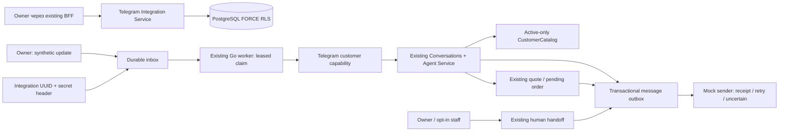

# Telegram: реализация этапа 6

13.10.2026. Рабочий контур — **mock transport + mock AI**, только отдельные `is_test` организации и синтетические сообщения. Telegram API, реальные боты/покупатели, публичный HTTPS webhook и туннель не подключались. HTTP adapter `getMe`/`sendMessage` есть и проверяется локальным HTTP test server; приложение намеренно не позволяет выбрать live transport. Состояние webhook честно показывает `synthetic_only`.

## Архитектура



Новых брокеров, сервисов и зависимостей нет. Worker продолжает dev email. Inbox —сама надёжная очередь, отдельная таблица jobs не нужна. Вход нормализуется: сохраняются только update ID, sender/chat ID, text либо callback, без username, имени или телефонного номера. Organization берётся по интеграции; пользовательские organization_id никогда не устанавливают scope.

## Локальная настройка

Сохраните существующий `.env` и volume. Добавьте отдельный случайный ключ (не AUTH_EMAIL_KEY, не бот-токен):

```sh
openssl rand -hex 32
```

Запишите результат только в ignored `.env` как `TELEGRAM_ENCRYPTION_KEY`. Не публикуйте вывод. Остальное:

```dotenv
TELEGRAM_TRANSPORT=mock
TELEGRAM_RETENTION_DAYS=7
LLM_PROVIDER=mock
LLM_ENABLE_LIVE=false
```

```sh
docker compose config --quiet
docker compose up --build -d --wait
sh scripts/migrate.sh status
```

Controlled migration job применяет `00005`, additive `00006` и `00007` перед API/worker. Readiness требует metadata7; старые migrations00001–00004 сохранены. Без ключа прежнее приложение запускается, Telegram-интеграция сообщает disabled. Production + enabled Telegram fail-closed до отдельного privacy/live approval. API и Mailpit опубликованы только на localhost, PostgreSQL не публикуется.

1. Войти и создать отдельный test shop через playground. Добавить синтетический active товар, цену и вручную сверенный stock.
2. `/dashboard/integrations/telegram?org=<UUID>`: owner вводит **`mock:10001`**, не реальный BotFather token. ID можно изменить для другого магазина; один bot ID глобально уникален. Один магазин —один бот; замена на другой bot ID намеренно запрещена. После disconnect можно подключить тот же бот заново.
3. В форме synthetic updates указать вымышленный положительный user/chat ID, уникальный update ID и текст с SKU. Нажать «Сохранить update». Worker обработает событие отдельно.
4. «Обновить состояние»: последние реальные записи mock-outbox показывают текст, status и `offer:<variant UUID>` из inline markup. Подать следующий synthetic callback с этой строкой, получить новое предложение5min; далее `confirm:<quote UUID>` отдельным действием тестирующего пользователя.
5. `/dashboard/conversations?org=<UUID>` показывает историю/карточки/канал. Handoff прекращает автоответы; в human режиме сотрудник может ответить. В Telegram-диалоге кабинет не имитирует customer и не подтверждает за него предложение.
6. `/dashboard/orders?org=<UUID>`: source=telegram, pending_confirmation, резерв0. Только сотрудник подтверждает/отклоняет/отменяет/завершает по правилам этапа5. Все изменения касаются test stock.
7. Повтор update ID не создаёт повторного события; повтор quote confirmation не создаёт повторной заявки. Разные боты с одинаковым внешним user ID получают независимые conversations/customers.

Mock receipt `sent` означает успешный вызов mock transport, **не доставку в Telegram**. Для просмотра новых входящих данных обновите страницу/состояние; push/SSE не реализованы.

## API

O=`/api/v1/organizations/{id}`. Existing sessions/BFF/Origin/CSRF; unknown/foreign organization404, default member403.

| Путь | Метод | Доступ |
|---|---|---|
| O/integrations/telegram | GET | owner / opt-in staff, sanitized metadata + последние10 deliveries |
| O/integrations/telegram/connect | POST token | owner, только mock:<ID> |
| O/integrations/telegram/check | POST | owner, decrypt + mock getMe, audit |
| O/integrations/telegram/disconnect | POST | owner, stop new claims + erase cipher + cancel pending sends |
| O/integrations/telegram/synthetic-updates | POST TelegramUpdate | owner, enabled development test scope; CSRF; quota30/min shared configuration |
| /api/v1/webhooks/telegram/{integration} | POST | integration-bound secret header, no session; enabled development only |

Существующие conversations/messages/handoff/resume/delete и orders/actions используются без второго auth/agent. Public webhook не проходит через BFF; route не регистрируется без enabled Telegram, а production enabled запрещён конфигурацией. Webhook принимает text/private message либо callback, body≤16KiB, JSON/trailing validation. Unknown Telegram metadata игнорируются; synthetic endpoint strict unknown fields. SHA256(header) проверяется constant-time в Go, затем DB снова проверяет binding/active/test scope. Global ingress quota1200/min и per-integration valid events120/min. ACK200 только после durable insert или при дубле. DB unavailable503; rejected secret403, invalid typed update422, malformed JSON400, limit429.

## Схема и матрица

`00005`: telegram_integrations (encrypted token, hash-only webhook secret, unique bot/org, mock mode, safe last_error); telegram_principals (integration/user/chat/customer conversation binding); telegram_inbox (unique integration/update, attempts/lease/capability/state); telegram_outbox (unique integration/logical message key, receipt/retry/uncertain); telegram_events (owner configuration audit). Compound tenant FK, FORCE RLS, aba_migrator owner/aba_app runtime; secret columns не доступны через table SELECT runtime.

| Principal | Доступ |
|---|---|
| owner | Настройки бота; chat/orders/test warehouse actions |
| member default | Нет chat/orders/integration доступа |
| member can_manage_orders | Read integration; human replies/control/order actions; настройки/каталог не меняет |
| Telegram leased customer | Active catalogue своего test org; собственный conversation/quotes/pending order; никаких inventory UPDATE/status transitions/settings |

Nullable audit actor_id для channel/system не подменяет user ID; customer UUID и telegram_principal связываются через conversation. Staff actions сохраняют реальный employee user ID. Quote/status/stock сервисы прежние; quote5min, price/availability recheck, manual freshness24h и reserve only staff.

## Внешняя совместимость и ограничения

Проверены [официальный Bot API](https://core.telegram.org/bots/api), прежний INTEGRATIONS contract. Для будущего реального канала нужны HTTPS setWebhook, secret_token, allowed_updates message/callback_query, getWebhookInfo/deleteWebhook/answerCallbackQuery, безопасное включение/выключение и реальные provider тесты. Нельзя объявлять webhook установленным без подтверждения Telegram. Эти внешние операции сейчас **не выполняются и не включены UI/config**. Группы, медиа, каналы/business accounts, массовая рассылка, real LLM и real PII вне этапа. Не считать mock проверкой BotFather credential/network accessibility/provider approval.

Команды/фактические результаты: [STAGE_6_REPORT](STAGE_6_REPORT.md). Надёжность: [MESSAGE_DELIVERY](MESSAGE_DELIVERY.md), безопасность: [TELEGRAM_SECURITY](TELEGRAM_SECURITY.md).

Ограничение Telegram mock сценария: inline offer выбирает один вариант и количество1. Existing Orders поддерживает до10позиций/количество1–10 в internal chat, Telegram cart UI/multi-selection отложены. Кнопки/quote/consent/результат сохраняются в conversation history, staff видит linked request.

Обновление с ранее применённой00005:00006 сохраняет данные, но требует owner reconnect того же mock bot для установки worker_hash. До reconnect legacy integration не обрабатывается. Не откатывать рабочую БД. Queue claim/send/purge требуют secret HMAC worker proof, raw runtime SQL без серверного ключа недостаточно.

## Подготовка этапа7

Default остаётся mock. Guarded live transport можно подготовить только с явным server authorization и тестовым allowlist; никакие getMe/webhook/sending не вызываются автоматически. Manual operations и prerequisites — PILOT_READINESS.md; реальный Telegram NOT RUN. SQL claim/send signatures расширены mode/allowlist в00007, есть org sending gate.

## 8Б.2 — совместимость многоканального слоя

Telegram webhook/principal/inbox/outbox остаются в прежних таблицах и API. Worker использует общий channel.Queue; inbound text передаётся в channel.Engine.Receive, offer/confirm — в общий Engine.Action, который повторно использует старые Conversation/Orders services. Guarded sender создаёт Telegram.Adapter с приватным pinned guard после прежнего admission; прямой Send без guard запрещён. Секретный заголовок, allowlist, leases, recovery UNKNOWN и disconnect сохранены. WhatsApp имеет собственные policy/credentials и не наследует TG identity. Физического переноса старых переписок/заявок нет. Подробнее MULTICHANNEL_ARCHITECTURE.
