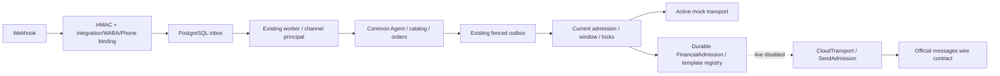

> Актуализация9В: durable admission дополнительно требует provider provenance и отсутствие конфликтующих policies; legacy owner financial/delivery mutation WhatsApp закрыта. Live по-прежнему disabled,0 RUB, real source adapter не установлен. См. STAGE_9C_REPORT.md.

# WhatsApp Cloud API transport — актуализация 9Б

## Область реализации

`internal/whatsapp/cloud.go`: HTTP transport официального messages wire contract. Не отдельный агент/каталог/заказы. Он реализует прежний `Transport.Send`; `Adapter.Send` использует транспортную `ValidateConfig`, не расширяя публичную mock-валидацию. Runtime API/worker по-прежнему создают `Mock{}`. Cloud transport не выбирается через dashboard или переменные live, попытки активации отвергаются существующим LoadWhatsApp.

## HTTP boundary

`NewCloudTransport(CloudOptions{})` не выполняет сеть и fail-closed. Fixed origin `https://graph.facebook.com/{GraphVersion}/{PhoneNumberID}/messages`; URL из сообщений/клиента не принимается. HTTPS, system certificate validation, direct transport без environment proxy, redirect запрещён. Context deadline, общий timeout default5s/max30s, dial/TLS/header timeout, response cap64KiB. Только POST JSON/Bearer; upstream body/recipient/credentials не включаются в ошибку и не логируются. Typed `CloudError` возвращает безопасные code/HTTPStatus/numeric ProviderCode.

Graph version **не выбрана**. `SupportedVersions` — обязательный server-side allowlist, сверяемый оператором с актуальной официальной документацией до будущей активации. Синтаксически валидного значения недостаточно; v0.0 не допускается. В тестах v99.0 — намеренно вымышленная версия. Никакой claims о текущей поддержке этой версии Meta нет; официальная документация по сети в этом этапе не запрашивается.

Отправка text, interactive reply buttons (нужны существующим quote-bound offers), отдельный `SendTemplate` с name/language/body text parameters. Template name/язык/число и размер параметров проверяются до HTTP. Нет загрузок media, произвольных components/URLs. Approved status устанавливает доверенный `SendAdmission`, а не параметр approved от клиента. Публичной отправки шаблонов нет; внутренний QueueTemplate использует прежний channel_outbox с typed payload и проверкой непосредственно перед dispatch.

## Admission и бюджеты

До HTTP проверяются flags Enabled/ExternalAuthorized, Kill, organization/platform budget или явная verified-free классификация, version, tenant/integration/allowlist/principal/direction, payload. Потенциально платная операция при нулевом бюджете блокируется. Исключение возможно только с AllowVerifiedFree и повторной DB-проверкой подтверждённого zero-cost правила; отсутствие цены не считается бесплатностью. Бюджеты приложения остаются0, Loader запрещает положительный WhatsApp budget и live; SQL mock schema также не разрешает live billing. Mock операции не используют деньги.

`FinancialAdmission.Reserve` — реализованная durable граница: проверяет текущие tenant/integration/lease/fencing/window либо approval/opt-in/template policy, известную стоимость и атомарно резервирует лимит организации и платформы по outbox correlation ID. Должна отказать повторному, settled или спорному in-flight допуску. `Finish` обязан идемпотентно сохранять результат/аудит, а UNKNOWN не освобождать как бесплатный. Ошибка Finish возвращается как SETTLEMENT_UNKNOWN. При отсутствии доверенной реализации HTTP заблокирован.

**9Б:** PostgreSQL ledger/reservation/settlement/recovery, approved-template registry и typed outbox интегрированы. Реальный конструктор требует durable FinancialAdmission и отвергает synthetic admission. Offline factory ограничена loopback URL. Подробности [WHATSAPP_FINANCIAL_ADMISSION](WHATSAPP_FINANCIAL_ADMISSION.md), [WHATSAPP_TEMPLATE_REGISTRY](WHATSAPP_TEMPLATE_REGISTRY.md). Фактическое live billing/Meta approvals/тарифы не проверялись: live config/mode запрещены, обе суммы0, trusted real provider ещё не подключён. Это не разрешение установить positive CloudOptions и отправлять запросы.

## Доставка и recovery

| Результат | Outbox-compatible state | Повтор |
|---|---|---|
| Validation/flags/budget/admission/cancel до HTTP | failed | нет отправки |
| 200 + ровно один валидный provider message ID | sent | не повторять |
| 400/401/403 и другие4xx кроме429 | failed | без авто retry |
| 429 | pending + bounded Retry-After (default60s/max3600s) | existing bounded outbox retry |
| 5xx, reset/timeout, redirect, oversized/broken response, 200 без ID | delivery_unknown | только ручное разрешение |
| Ошибка финансового settlement | delivery_unknown | спорный резерв не считать свободным |

Встроенного retry loop нет. HTTP не выполняется в SQL-транзакции. Existing worker держит integration session lock, lease/fencing, повторно проверяет admission, сохраняет ProviderID в queue finish. Exactly-once внешняя отправка не обещается. Cloud транспорт совместим с этой границей через прежние SendResult states; реальные credentials/положительные budgets не подключены.

## Конфигурация и секреты

Tenant credentials App Secret/Verify Token/Access Token уже хранятся AES-GCM с server key и tenant AAD; текущий Connect допускает только mock credentials. Подготовлены App/WABA/Phone ID и Graph version; новые реальные значения не вводились. `WHATSAPP_SENDING_KILL_SWITCH=true` зафиксирован в compose и example; выключение loader отвергает. Этот gate относится к live; mock-отправка управляется существующим integration.sending_enabled и не считается внешней отправкой. UI явно говорит mock/live disabled/disconnected, не предлагает live activation.

Для будущей ротации отдельно согласовать новые credentials, сохранять через owner-only server boundary, затем удалить старые после проверки queued jobs; не передавать токен в чат/CLI arguments/frontend bundle. Утечка токена требует отзыва у Meta, но эта внешняя операция сейчас не выполняется.

Финансовый и delivery исход разделены: confirmed reject/429 не равен подтверждённому нулевому расходу. NoChargeConfirmed выставляется только trusted backend при доказанном отсутствии HTTP; иначе ledger удерживает unknown. Никакого generic text fallback для template jobs.
